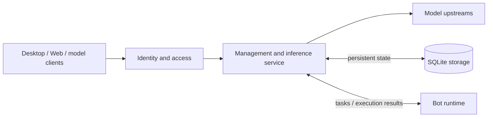
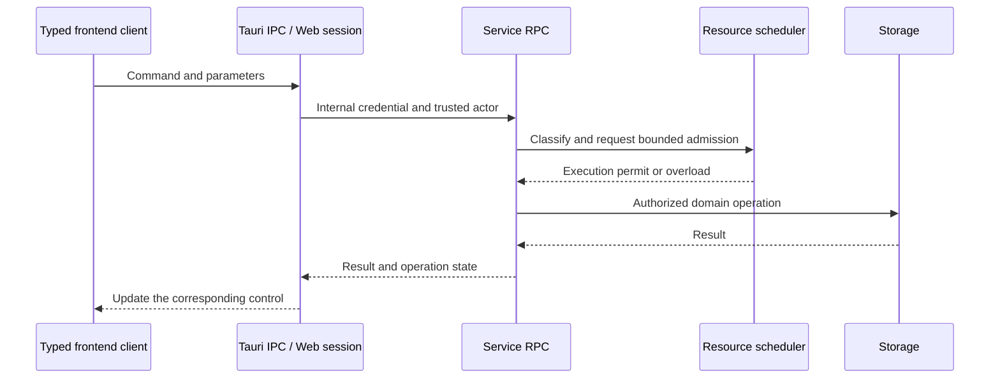
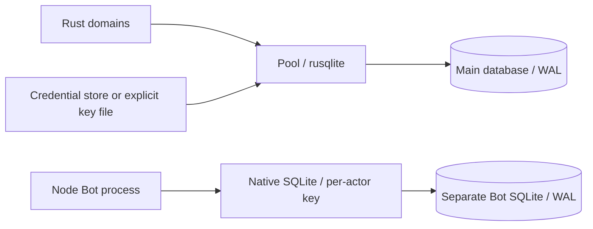
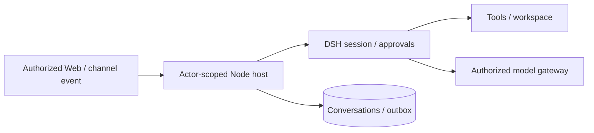
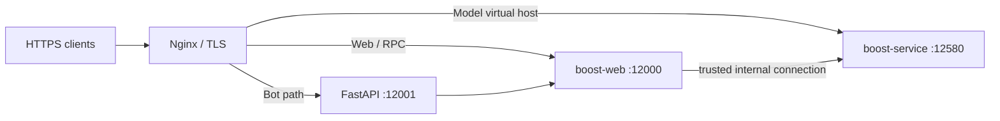

# System architecture

[简体中文](ARCHITECTURE.zh-CN.md) · [Overview](README.md) · [Configuration](docs/CONFIGURATION.md)

Boost shares one Rust service across desktop management, Web management, model inference and agent execution. Identity boundaries and resource budgets separate these paths. SQLite owns persistence; Nginx and FastAPI are optional deployment components.

## Overall data flow

This overview shows business data flow. The following diagrams describe individual technology areas; an installation does not require every component.

## Components and processes

| Component | Technology | Responsibility |
| --- | --- | --- |
| `frontend/` | Vue 3, TypeScript, Vue Router, Vite 7 | Management UI, typed clients and static route output |
| `backend/desktop/` | Tauri 2, Rust, native WebView | IPC, windows/tray, floating monitor, local lifecycle and custom updater |
| `backend/web/` | Axum, Tokio, embedded static assets | Sessions, actor derivation, runtime discovery and RPC/Bot proxy |
| `backend/service/` | Rust, Axum/Tokio, tiny_http, reqwest | Domains, JSON-RPC, inference gateway, accounting and Bot hosting |
| `backend/core/` | rusqlite, SQLite/SQLCipher, SQL migrations | Storage, auth primitives, integrity and settlement identity |
| `backend/start/` | Rust child-process orchestration | Coordinated Service/Web startup and shutdown |
| `bot/` | Node.js, TypeScript, native SQLite3 Multiple Ciphers, Vue, DSH | Stateful agents, conversations, approvals, tools, channels and separate storage |
| `bot/backend/api/` | Python, FastAPI, Uvicorn, HTTPX | Optional asynchronous Bot ingress with bounded admission |
| `nginx/`, `docker/` | Nginx, Docker Compose | TLS, forwarding, container networks and persistent volumes |

Desktop uses managed loopback Rust/Node processes without Nginx or Python. Self-hosted users can access Web directly on port 12000 or use Nginx. FastAPI runs only when the corresponding Bot ingress is selected.

## Management RPC

| Layer | Budget | Scope |
| --- | --- | --- |
| Frontend runtime | 6 outstanding RPCs | Not shared across browser tabs |
| Service writes | 6 executing, at most 256 waiting, 60 s queue deadline | Shared by async and legacy HTTP entrypoints in one process |
| Resource lanes | Serial execution, at most 32 waiting per lane | Accounts, keys, models, billing, Bot and settings; maintenance separately |
| Read lane | 16 active, immediate rejection when full | Explicitly reviewed read methods only |
| Cross-domain changes | Global read/write barrier | Deletion, ownership, reload and unknown methods use conservative scheduling |

A task waits for its resource before taking a global execution slot. A hot resource therefore cannot consume every execution slot while waiting on its own lock. Reads do not accumulate a hidden queue; cancellation releases admission. Client timeout after execution begins does not imply rollback, and proxies must not replay writes.

Sources: [classification](backend/service/src/http/rpc_policy.rs), [scheduler](backend/service/src/http/rpc_queue.rs), [typed transport](frontend/src/lib/api/transport.ts).

## Inference gateway

```mermaid
flowchart LR
  Request["Inference request"] --> Auth["Key / model / local budget"]
  Auth --> Limits["Rate and in-flight admission"]
  Limits --> Route["Source / cooldown / circuit"]
  Route --> Adapter["Protocol adapter"]
  Adapter --> Upstream["Model provider"]
  Upstream --> Result["JSON / SSE / tools"]
  Result --> Settlement["Usage and cost settlement"]
```

Inference and management use separate budgets. Process-local token buckets, model concurrency, request size and buffered-body limits reject temporary overload with 429 and Retry-After. Streams retain capacity until completion or cleanup; model admission creates no unbounded waiting queue.

Defaults are 20 QPS, burst 20, 24 global in-flight requests and 8 per model; per-key RPM is disabled until configured. Effective concurrency also reserves storage headroom: the default 32-connection pool leaves 8 positions for management. Request bodies default to 32 MiB each and 64 MiB of buffered inference input. The front proxy permits 64 active forwards and streams uploads with backpressure instead of aggregating a second complete copy.

Circuits isolate stable account and aggregate-source IDs. A 60-second window uses one-second buckets; at least 20 eligible samples and an error rate strictly greater than 50% open a circuit for 30 seconds. Half-open admits one logical probe. Client errors, local limits and cancellation do not count as provider failures; upstream 429 uses separate cooldown policy. Retry decisions must account for already-delivered stream bytes and tool side effects.

Settlement derives a unique identity from the server trace and key. Historical rows remain unchanged. Request logs and token data commit in one transaction; duplicate finalization reuses the event, and wallet charges are idempotent by request-log ID. Rate and in-flight admission are distinct from strict cumulative-budget reservation; durable cross-process recovery is outside the current reservation contract.

Sources: [admission](backend/service/src/gateway/request_limits.rs), [circuits](backend/service/src/gateway/routing/circuit.rs), [gateway modules](backend/service/src/gateway/README.md).

## SQLite and encryption

Both Rust and Node bindings access SQLite. Bot previously used node:sqlite and now uses an encryption-capable native binding with authenticated ChaCha20 protection. Main SQLCipher and Bot storage have independent process ownership, keys and file formats.

| Capability | Behavior |
| --- | --- |
| WAL | Verify the selected journal mode; default NORMAL and 5 s busy timeout |
| Read-only access | No creation/migration; read-only open flags and query_only |
| Checkpointing | Routine PASSIVE checkpoints; startup pruning avoids blocking TRUNCATE/VACUUM |
| SQLCipher | Included in the default build, explicitly enabled at runtime; existing plain configurations remain compatible |
| Keys | System credential store or explicitly configured private key file; absent from database settings, responses and logs |
| Conversion | Close other connections, export encrypted staging data, validate integrity/counts/version, then replace; no automatic backup |
| Failure | Wrong/missing keys and corruption fail storage initialization instead of silently creating an empty database |

Main encryption derives independent per-actor Bot keys, passed through the owned child's private bootstrap pipe. Existing Bot databases convert on their next host start; inactive stores are not claimed migrated before that event. Workspace files and logs remain outside database encryption. Settings display the main state and restart requirement. Desktop data defaults to `~/.boost`; standalone paths use executable-relative defaults or explicit overrides. See [build and storage](docs/BUILDING.md).

## Bot execution

Web derives the actor from the session; Service enforces ownership and hosts the process. Bots use authorized platform keys for inference. Channel signatures and message deduplication remain independent of internal RPC authentication. Browsers do not receive internal RPC credentials. Working-directory restrictions and approvals are not equivalent to OS sandboxing; OS sandboxing requires separate platform-specific enforcement.

## Nginx and network ingress

Nginx preserves session anchors, supported WebSocket upgrades and stream bytes. RPC replay is disabled. `proxy_read_timeout` measures inactivity between reads, not total request duration; upstream keepalive caches idle connections and is not a global concurrency limit.

The Bot virtual host permits 512 connections. FastAPI defaults per worker are 256 active, 512 waiting, a 15 s queue deadline and a 64 MiB body budget. Multiple processes have separate limits. Public callers cannot select an internal actor or RPC credential; container loopback identifies that container only.

Sources: [Nginx](nginx/README.md), [Bot ingress](bot/backend/api/README.md), [Docker](docker/README.md).

## Build and verification

The root Cargo workspace contains core/service/web/start; desktop retains its independent lockfile. Vite emits `frontend/out`; Web embeds that output and Tauri references it. Node/Bot preparation precedes packaging.

The launcher restarts its owned Service/Web children with a bounded exponential budget and allows up to 30 seconds for owned services to exit. Signed-update verification and main/Bot storage have separate regressions. Schema-compatible rollback, durable quota recovery and platform sandboxing remain explicit follow-up gates.

[Validation](TESTING.md) · [Configuration](docs/CONFIGURATION.md) · [Security](SECURITY.md)
