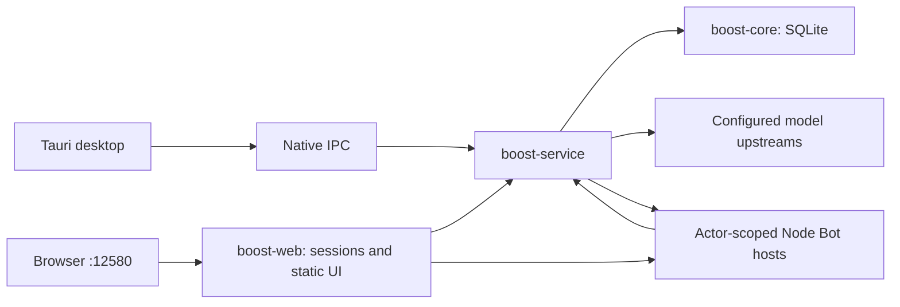

# Architecture / 系统架构

[English overview](README.md) · [中文首页](README.zh-CN.md) · [Module index](docs/README.md)

Boost has three source boundaries: **frontend**, **backend**, and **Bot**. The normal local/hosted Web entry is **12580**.

## Process boundaries / 进程边界

| Location | Owns / 职责 |
| --- | --- |
| `frontend/` | Vue interface, UI preferences and typed API transport / 管理界面和类型化传输 |
| `backend/core/` | Migrations, shared data and persistence / 数据结构与持久化 |
| `backend/service/` | Authorization, gateway routing and service domains / 授权、网关及服务领域 |
| `backend/web/` | Sessions, embedded UI, RPC and Bot proxy / 会话、静态界面及代理 |
| `backend/start/` | Service + Web lifecycle / 联合启动 |
| `backend/desktop/` | Native window, tray, IPC and updater / 桌面原生行为 |
| `bot/` | Agent execution, channels, tasks, tools and Bot UI / 智能体与 Bot 界面 |

## Transport and persistence / 传输与存储

- Desktop clients use centralized Tauri IPC. Browser clients use authenticated Boost Web RPC. Typed frontend wrappers live in `frontend/src/lib/api/`.
- Server-side roles, key ownership, model access, billing and quota checks are authoritative.
- SQLite migrations belong to `backend/core/migrations/`. New persisted settings need defaults, storage and runtime synchronization.
- Desktop storage defaults to platform application data. Standalone service storage defaults beside the executable; explicit configuration overrides are documented in the operating manuals.
- Bot identities use separate state below the active database directory. Model secrets enter child hosts server-side and are not sent to the browser.

桌面与 Web 共享服务端授权策略；界面不持有最终授权决定。数据库迁移归属 core，原生窗口和系统行为归属 desktop，Bot 能力沿用现有网关与身份边界。

## Build boundaries / 构建边界

The root Cargo workspace contains `core`, `service`, `web`, and `start`. `backend/desktop` remains an independent package with its own lockfile and target directory. Vite emits `frontend/out`; Web embeds that output and Tauri points to it. Bot preparation produces its runtime assets before packaging.

根工作区与桌面包分别构建；前端只在 `frontend/` 维护，Bot 运行资源只从根 `bot/` 准备。详见 [BUILDING.md](docs/BUILDING.md) 与 [Bot integration](bot/INTEGRATION.md)。
