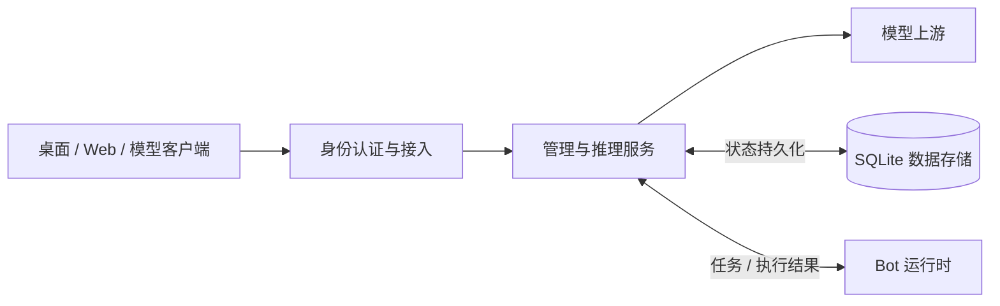
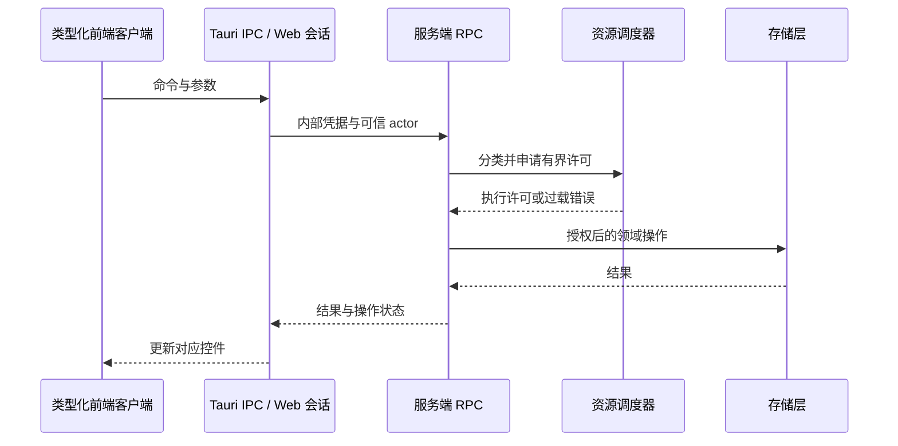
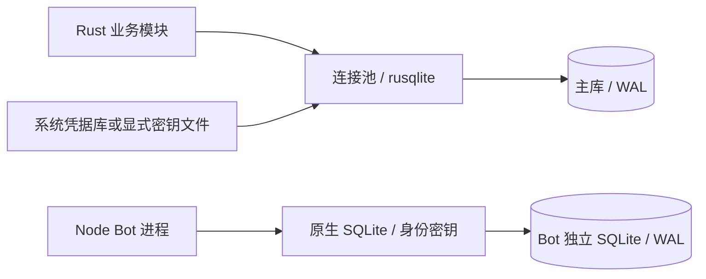
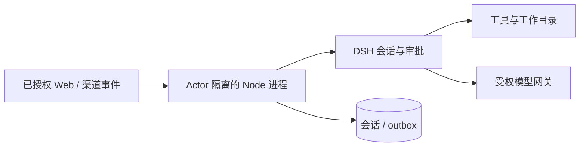
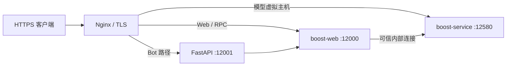

# 系统架构

[English](ARCHITECTURE.md) · [项目首页](README.zh-CN.md) · [配置参考](docs/CONFIGURATION.zh-CN.md)

Boost 采用共享 Rust 核心服务，分别承接桌面管理、Web 管理、模型推理和 Bot 执行。架构按数据流、身份与资源预算划分，SQLite 负责持久化，Nginx 和 FastAPI 为可选部署组件。

## 整体数据流

首图只描述业务数据流。下文分别说明 RPC、推理、存储、Bot 与反向代理，不要求每种安装同时运行全部组件。

## 技术与进程边界

| 组件 | 技术 | 责任 |
| --- | --- | --- |
| `frontend/` | Vue 3、TypeScript、Vue Router、Vite 7 | 管理界面、类型化客户端、静态路由输出 |
| `backend/desktop/` | Tauri 2、Rust、原生 WebView | IPC、窗口与托盘、悬浮监控、本机服务与自定义更新 |
| `backend/web/` | Axum、Tokio、嵌入式静态资源 | Web 会话、身份推导、运行时发现、RPC/Bot 代理 |
| `backend/service/` | Rust、Axum/Tokio、tiny_http、reqwest | 管理领域、JSON-RPC、推理网关、计量和 Bot 托管 |
| `backend/core/` | rusqlite、SQLite/SQLCipher、SQL 迁移 | 存储、认证基础、完整性与结算唯一性 |
| `backend/start/` | Rust 子进程编排 | Service/Web 联合启动与退出 |
| `bot/` | Node.js、TypeScript、原生 SQLite3 Multiple Ciphers、Vue、DSH | 有状态智能体、会话、审批、工具、渠道和独立数据库 |
| `bot/backend/api/` | Python、FastAPI、Uvicorn、HTTPX | 可选的异步 Bot 接入与有界准入 |
| `nginx/`、`docker/` | Nginx、Docker Compose | TLS、代理、容器网络与持久卷 |

桌面版使用受管 loopback Rust/Node 进程，不需要 Nginx 或 Python。自托管用户可直接访问 Web 端口 12000，也可通过 Nginx 接入；FastAPI 只在选用相应 Bot 路由时运行。

## 管理 RPC

| 层次 | 预算 | 边界 |
| --- | --- | --- |
| 前端运行实例 | 最多 6 个在途 RPC | 不跨标签页共享 |
| 服务写任务 | 全局最多 6 个执行、256 个等待、60 秒排队期限 | 同一进程的异步和同步入口共用 |
| 资源分片 | 每资源串行，最多 32 个等待 | accounts、keys、models、billing、bot、settings；维护单独处理 |
| 只读通道 | 最多 32 个执行，含等待共 96 个，排队上限 2 秒 | 仅显式审查的只读方法进入 |
| 跨资源变更 | 全局读写屏障 | 删除、归属调整、配置重载及未知方法采取保守策略 |

调度器先等待资源，再申请全局执行名额，因此同一资源的等待任务不会耗尽其他资源的执行位。读请求等待执行位时不持有共享锁；排队取消释放许可。执行后的客户端超时不等于业务回滚，写操作禁止代理自动重放。

实现依据：[分类表](backend/service/src/http/rpc_policy.rs)、[调度器](backend/service/src/http/rpc_queue.rs)、[前端传输](frontend/src/lib/api/transport.ts)。

## 推理网关

管理 RPC 与推理使用独立预算。推理采用进程内令牌桶、模型在途限制、请求体限制与缓冲预算；达到临时容量时返回 429 和 Retry-After，不建立无限等待队列。长流保留许可直到结束或清理完成。

默认全局 20 QPS、突发 20、最多 24 个推理在途、每模型 8 个在途，key RPM 默认关闭。实际在途上限还受连接池余量约束，默认 32 连接池为管理操作预留 8 个位置。单请求体默认 32 MiB，推理输入缓冲预算默认 64 MiB；前置代理最多 64 个转发在途，并采用背压转发，避免重复聚合完整请求体。

熔断按稳定来源 ID 隔离账号与聚合渠道。60 秒窗口采用 1 秒统计桶，至少 20 个有效样本且错误率严格大于 50% 时打开 30 秒，半开仅允许一个逻辑探测。客户端错误、本地限流与取消不计作上游故障；上游 429 继续走独立冷却。已输出流式内容或产生工具副作用的请求不能当作无副作用任务重放。

结算使用服务生成的 trace 与 key 组成唯一身份，历史无身份记录保持原样。请求日志与 Token 数据在同一事务提交；重复 finalize 复用结算事件，钱包按请求日志 ID 幂等扣费。限速和在途控制不等于严格的累计预算预留；持久跨进程恢复不属于当前预留实现。

实现依据：[资源限制](backend/service/src/gateway/request_limits.rs)、[熔断](backend/service/src/gateway/routing/circuit.rs)、[协议模块](backend/service/src/gateway/README.md)。

## SQLite 与加密

Rust 与 Node 都访问 SQLite；Bot 原先使用 node:sqlite，现在使用支持 ChaCha20 认证加密的原生驱动。主库 SQLCipher 与 Bot 库的进程、密钥和文件格式独立。

| 存储能力 | 行为 |
| --- | --- |
| WAL | 打开文件库时核验返回值；默认 NORMAL、5 秒 busy timeout |
| 只读访问 | 不创建、不迁移，使用只读打开标志与 query_only |
| 检查点 | 常规维护使用 PASSIVE；启动清理不执行阻塞式 TRUNCATE/VACUUM |
| SQLCipher | 默认构建包含支持，运行时显式启用；保留既有未加密配置兼容性 |
| 密钥 | 桌面系统凭据库，或服务明确配置的私有密钥文件；不写入数据库、响应或日志 |
| 转换 | 关闭其他连接后导出加密暂存库，验证完整性、行数与版本，再替换源库；不自动创建备份 |
| 失败语义 | 错密钥、缺密钥或损坏使存储初始化失败，禁止静默初始化空库 |

主库加密后派生每身份 Bot 密钥，经受管子进程私有启动管道传入。既有 Bot 库在对应宿主下次启动时转换，不能在此之前宣称所有非活跃库已迁移。工作文件和日志不受数据库加密覆盖。设置展示主库状态及重启要求。桌面默认 `~/.boost`，独立服务使用程序相对默认值或显式覆盖；见[构建与存储](docs/BUILDING.zh-CN.md)。

## Bot 执行

Web 从会话推导 actor，服务负责归属检查和进程托管。Bot 通过受权平台 key 调用模型，渠道保留签名校验与消息去重，浏览器不获得内部 RPC 凭据。工作目录和审批不等同操作系统沙箱，系统沙箱需要独立的平台级执行约束。

## Nginx 与网络接入

Nginx 保留会话锚点、WebSocket upgrade 和流式字节；RPC 代理禁止自动重放。`proxy_read_timeout` 是相邻读取之间的空闲期限，不是请求总时长；upstream keepalive 是空闲连接缓存，不是全局并发上限。

Bot 虚拟主机连接上限为 512；FastAPI 每 worker 默认 256 活跃、512 等待、15 秒排队、64 MiB 请求体缓冲。多进程各有预算，不提供跨实例全局限额。公共请求不能指定内部 actor 或 RPC token；容器 `127.0.0.1` 仅指当前容器。

## 构建与验证

根 Cargo 工作区包含 core/service/web/start，桌面包保留独立 lockfile。Vite 输出 `frontend/out`，Web 嵌入此产物，Tauri 引用同一产物；Node/Bot 资源在打包前准备。

启动器对其创建的 Service/Web 使用有界指数重启预算，退出时为子进程预留最多 30 秒。更新验签及主/Bot 加密分别有回归。schema 兼容回退、持久额度恢复与平台沙箱仍需独立验收。

[验证要求](TESTING.md) · [配置](docs/CONFIGURATION.zh-CN.md) · [安全](SECURITY.md)
