<p align="center"></p>

<h1 align="center">Boost</h1>

<p align="center">A self-hosted AI account manager, compatible model gateway, and agent workspace.</p>

<p align="center"><a href="README.zh-CN.md">简体中文</a> · <a href="docs/README.md">Documentation</a> · <a href="SECURITY.md">Security</a> · <a href="https://github.com/amine123max/Boost-bot/releases">Releases</a></p>

<p align="center">
  
  
  
  
  
  
  
</p>

Boost is a desktop and self-hosted workspace for managing AI accounts, routing model requests and running agents. It combines a Rust gateway, a Vue interface and an embedded Node.js Bot runtime, with SQLite persistence and shared authorization across desktop and Web deployments.

[](https://github.com/amine123max/Boost-bot/actions/workflows/release-all.yml)
[](https://github.com/amine123max/Boost-bot/releases/latest)
[](LICENSE)

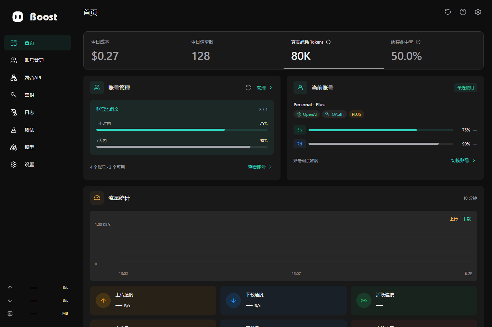

## Linux DO community and acknowledgements

Boost is an independent open-source project shared with the [Linux DO](https://linux.do/) community. Community feedback and contributions are welcome. It is independently maintained and is not an official Linux DO project.

Thanks to Linux DO for providing a place for technical discussion and open-source sharing.

## Releases

**[Download the latest release](https://github.com/amine123max/Boost-bot/releases/latest)** · [Release history and notes](https://github.com/amine123max/Boost-bot/releases)

| Platform | Package |
| --- | --- |
| Windows x64 | Portable EXE and NSIS installer on the [latest release](https://github.com/amine123max/Boost-bot/releases/latest) |
| macOS Apple Silicon | DMG on the [latest release](https://github.com/amine123max/Boost-bot/releases/latest) |
| Integrity | [Latest SHA-256 checksums](https://github.com/amine123max/Boost-bot/releases/latest/download/SHA256SUMS.txt) |

## Capabilities

| Area | Technical scope |
| --- | --- |
| Account management | Authorization, import, availability checks and usage windows |
| Model gateway | Responses / Chat Completions, JSON / SSE, tools, source mapping and failover |
| Access and accounting | Key ownership, model access, token budgets, rate/concurrency admission and idempotent settlement |
| Agent workspace | Conversations, tasks, approvals, tools and signed messaging channels |
| Operations | Source circuits, request diagnostics, bounded queues, upstream proxies, managed sing-box and native monitoring |

Protocol support depends on the configured upstream. Main SQLCipher and per-actor Bot encryption are explicitly enabled; workspaces/logs are outside database encryption. Acceptance and remaining work are tracked in the [engineering plan](update.en.md).

## Architecture

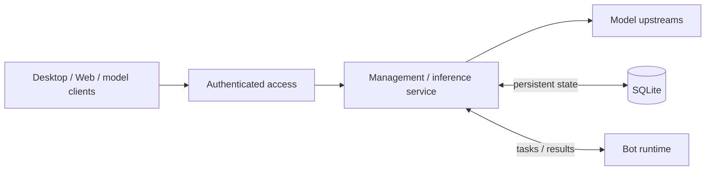

Direct Web access uses port **12000**. Desktop runs its own managed Rust/Node runtime; Nginx and FastAPI are optional. See [system architecture](ARCHITECTURE.md) for RPC budgets, identity boundaries, persistence and stream handling.

| Layer | Technical responsibilities |
| --- | --- |
| Vue 3 / TypeScript / Vite | Typed clients, shared desktop/Web UI and static route output |
| Tauri 2 / Rust | Native IPC, windows/tray, managed local services and desktop updates |
| Axum / Tokio / tiny_http | Session gateway, JSON-RPC dispatch, bounded management admission and HTTP compatibility |
| reqwest / protocol adapters | Model routing, HTTP JSON, SSE, supported WebSocket paths and tool-call translation |
| SQLite / SQLCipher / Node native binding | Main and actor-scoped Bot databases, WAL, verified conversion and independent key derivation |
| Nginx / FastAPI | Optional TLS ingress, authenticated forwarding, stream preservation and bounded Bot admission |
| Node.js / DSH / sing-box | Stateful agents and tools; optional managed upstream network egress |

| Resource boundary | Default policy |
| --- | --- |
| Management RPC | 6 executing writes, bounded resource queues, 16 read slots, cross-domain barrier |
| Inference | 20 QPS / burst 20, 24 global and 8 per-model in-flight; storage headroom preserved |
| Input memory | 32 MiB per body, 64 MiB buffered inference input; front-proxy backpressure |
| Upstream faults | Source-isolated circuits, bounded half-open probing and healthy-source failover |
| Data protection | Explicit SQLCipher main storage; derived per-actor Bot keys; wrong-key fail-closed startup |
| Releases | Ed25519-signed asset manifest bound to tag, source commit, platform and SHA-256 |

These are per-process budgets. Deployment capacity and latency depend on hardware, payloads and upstreams; see the [load validation](docs/PERFORMANCE.md).

## Screenshots

**Account pool**

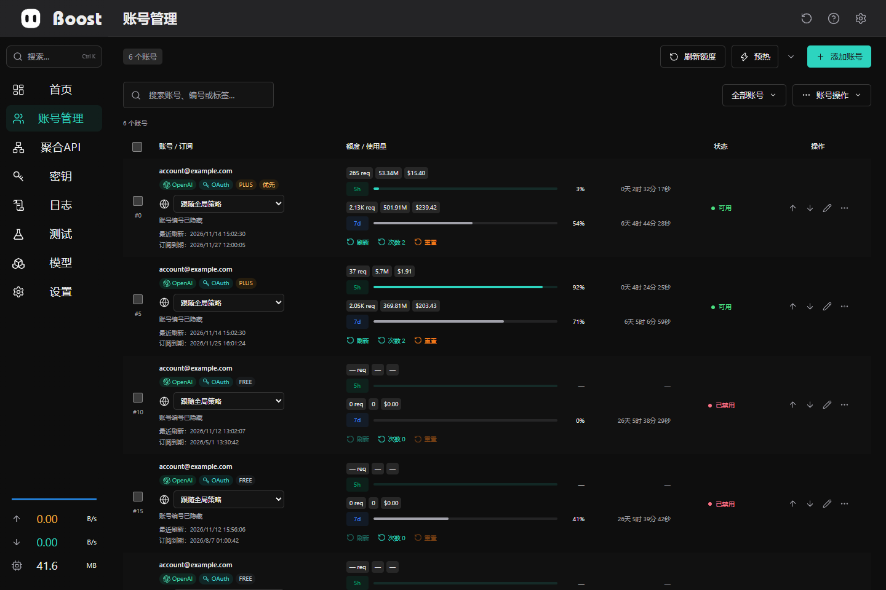

<br />

**Model workspace**

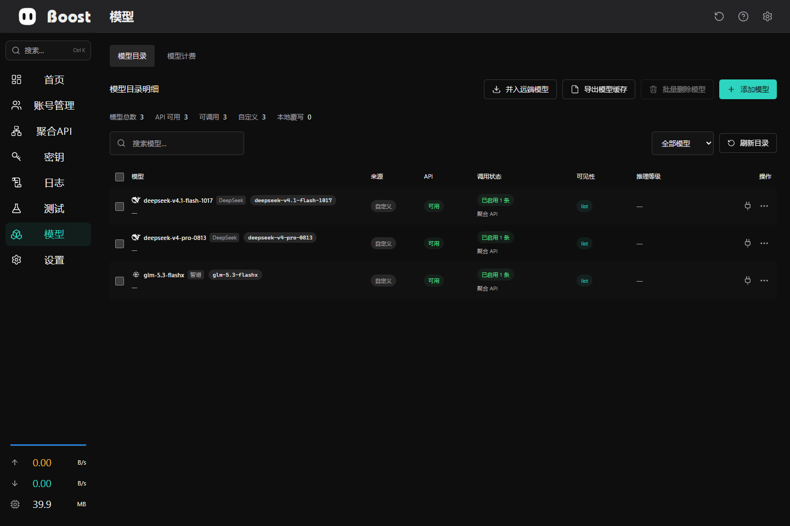

<br />

**Platform keys**

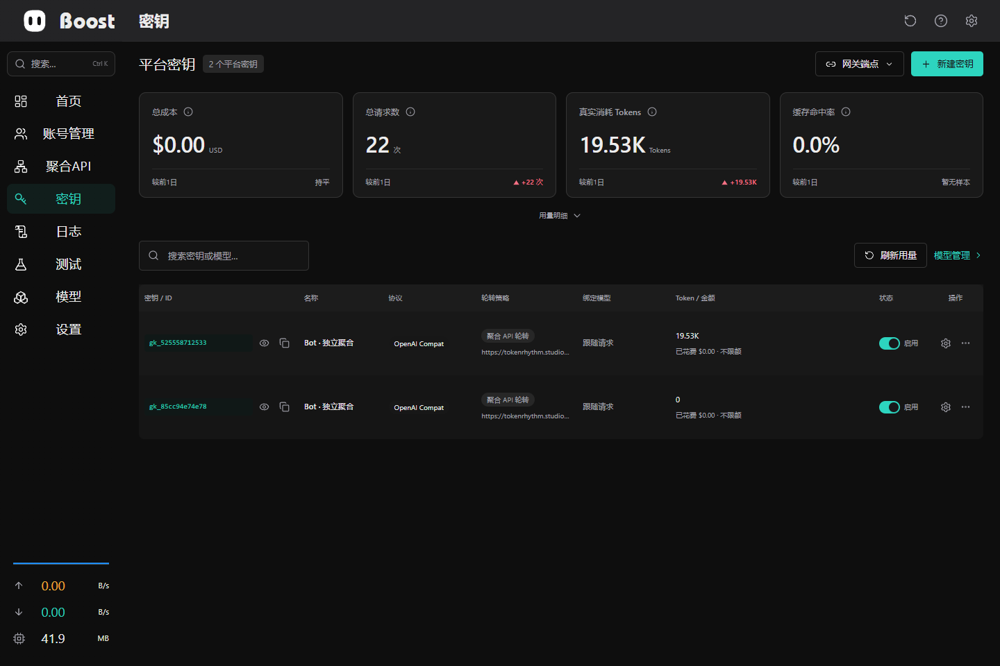

<br />

**Bot workspace**


<br />

**Bot library**

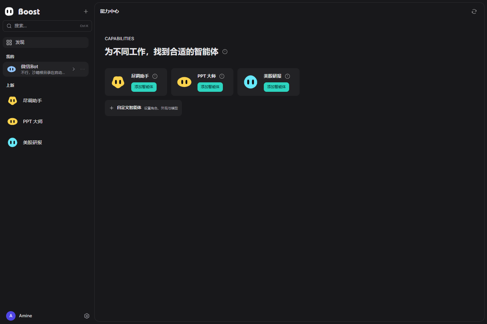

<br />

**Bot model sources**

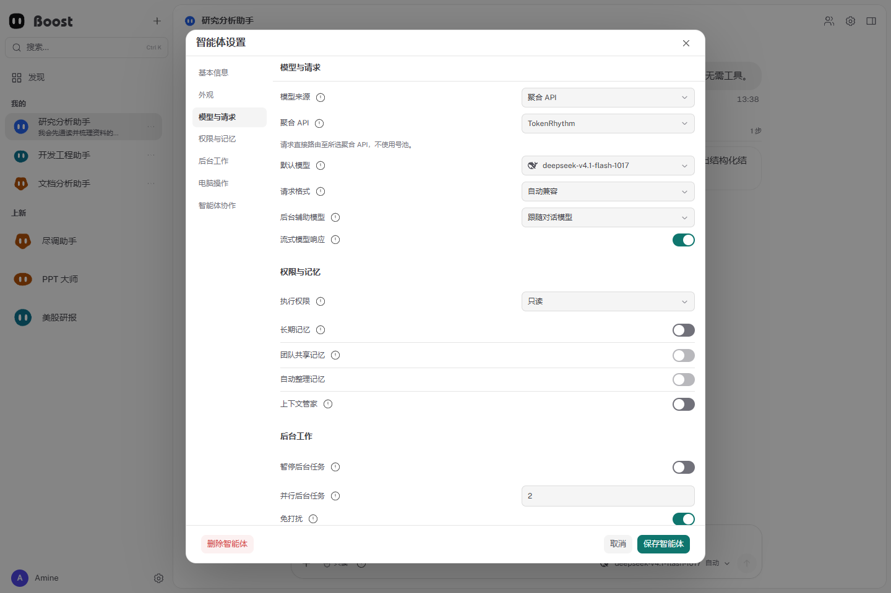

<br />

**Bot settings**

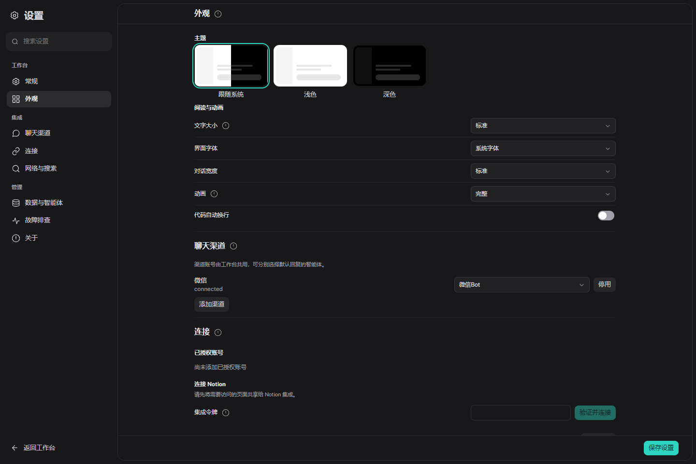

<br />

**Bot storage**

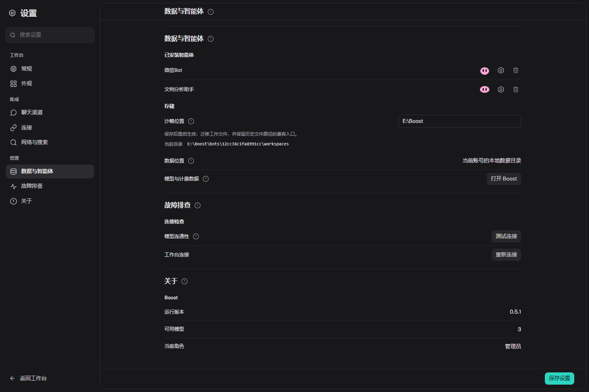

<br />

**Tasks, channels and approvals**

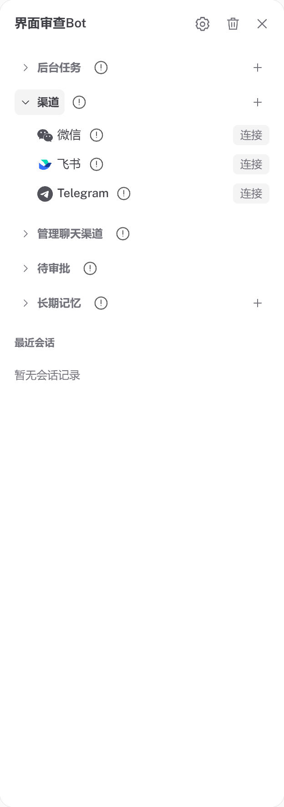

<br />

**Appearance settings**

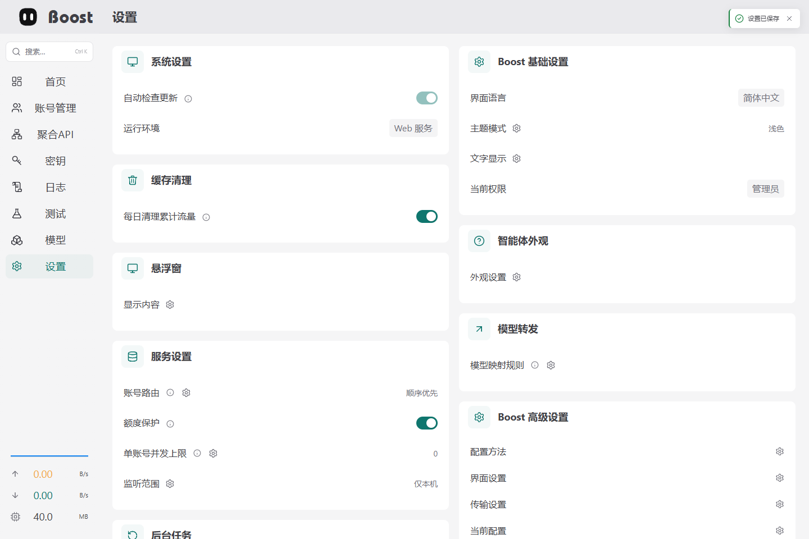

<br />

**Gateway settings**

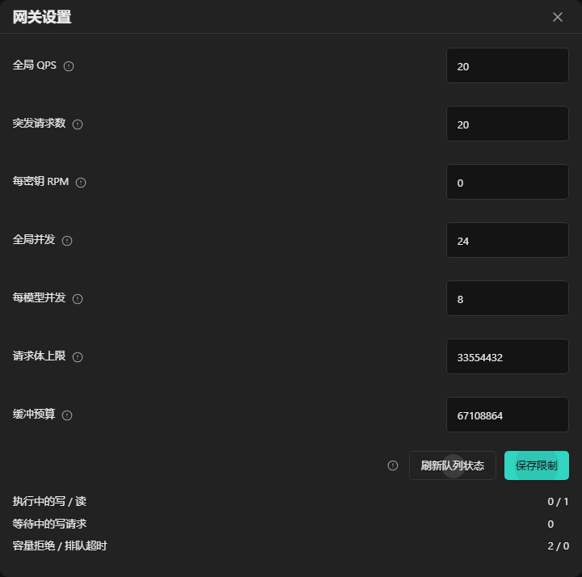

<br />

**Storage security**

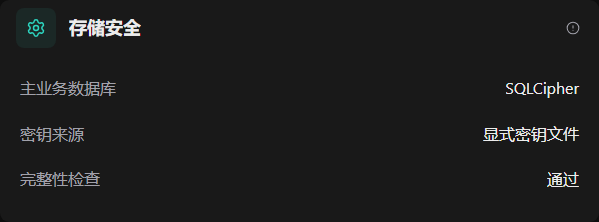

<br />

Screenshots use isolated demonstration data. [Interface gallery](docs/SCREENSHOTS.md) groups the views by subsystem.

## Quick start

**Prerequisites:** Node.js 22.13+ (24 LTS recommended), pnpm 10.30.3, stable Rust and a native C/C++ toolchain. See [platform dependencies](docs/BUILDING.md#platform-dependencies--系统依赖).

**Install and build** from a source checkout:

```sh
git clone https://github.com/amine123max/Boost-bot.git
cd Boost-bot
pnpm -C frontend install --frozen-lockfile
node scripts/prepare-boost-bot.mjs
pnpm -C frontend run build:desktop
cargo build --locked -p boost-service -p boost-web -p boost-start
```

**Run:**

```sh
cargo run --locked -p boost-start
```

**Verify:** open [http://localhost:12000](http://localhost:12000); the management UI or sign-in screen should load. This verifies startup; model calls require a configured upstream and platform key. [Desktop packaging and Docker](docs/BUILDING.md) have separate instructions.

## Configuration and documentation

| Topic | Reference |
| --- | --- |
| Runtime configuration and environment example | [Configuration](docs/CONFIGURATION.md) · [.env.example](.env.example) |
| Components, RPC, Nginx and persistence | [Architecture](ARCHITECTURE.md) |
| Build, storage and deployment | [Build guide](docs/BUILDING.md) · [Docker](docker/README.md) · [Nginx](nginx/README.md) |
| Agent runtime and channel integration | [Bot](bot/README.md) · [Integration](bot/INTEGRATION.md) |
| Usage and diagnostics | [Usage](docs/USAGE.md) · [Operating manuals](docs/README.md) |
| Screenshots | [Interface gallery](docs/SCREENSHOTS.md) |

## Contributing and security

See [contribution workflow](CONTRIBUTING.md), [validation commands](TESTING.md) and [security reporting](SECURITY.md). Release jobs are defined in the [release workflow](.github/workflows/release-all.yml); its status badge describes release builds, not a separate pull-request CI pipeline.

## License

Licensed under [MIT](LICENSE); redistribution must preserve [third-party notices](bot/THIRD_PARTY_NOTICES.md).

[](https://star-history.com/#amine123max/Boost-bot&Date)
