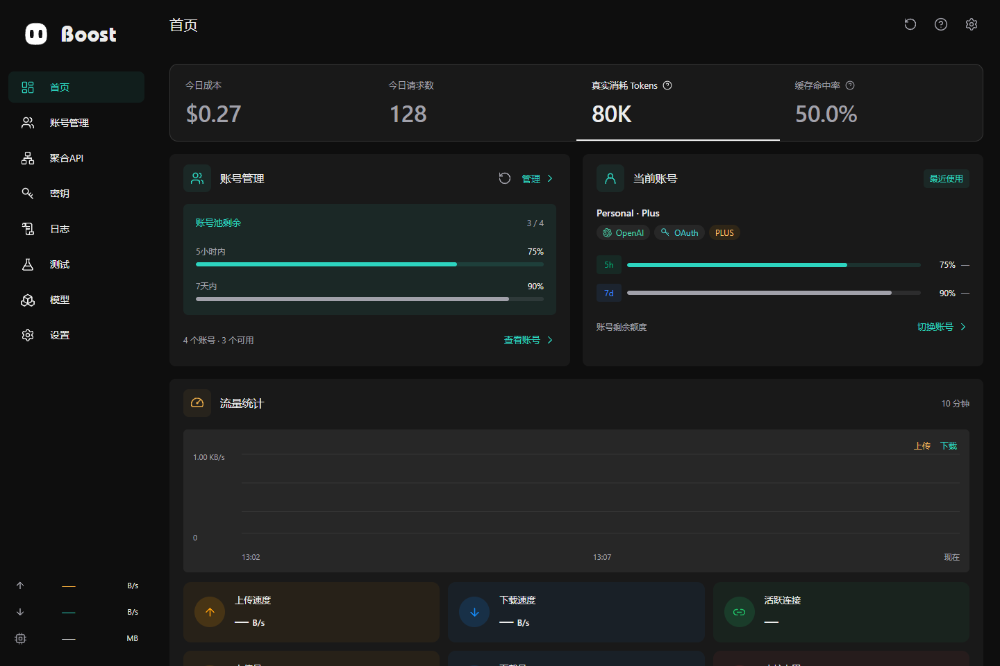
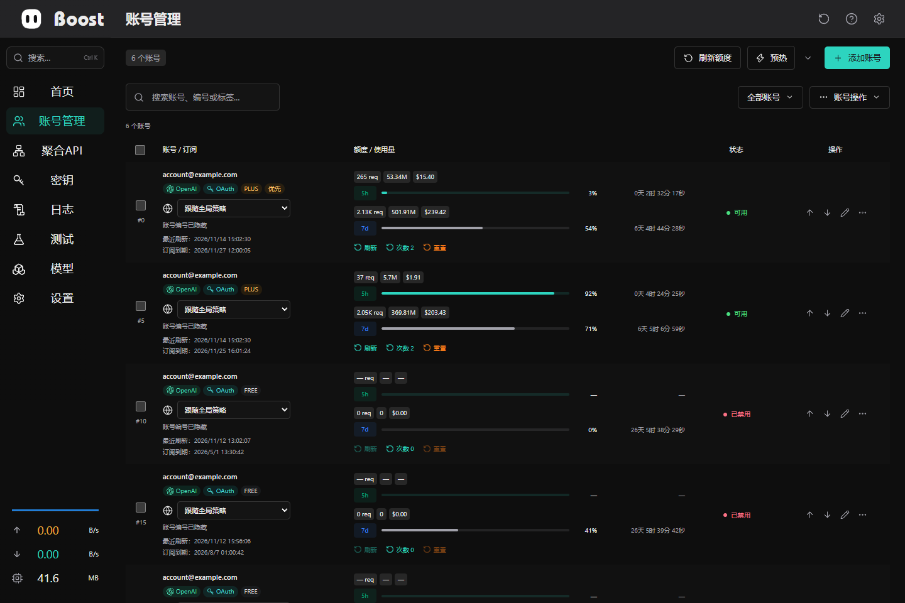
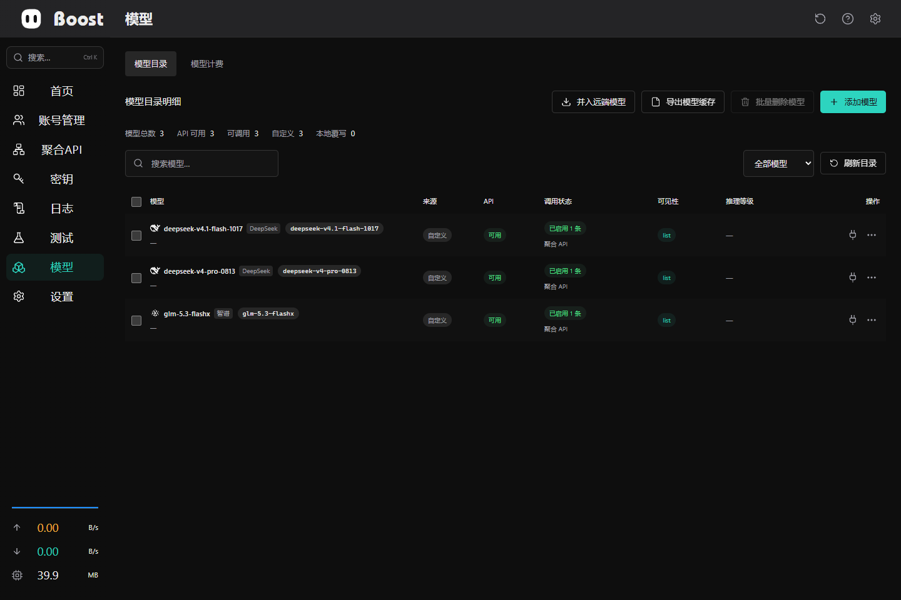
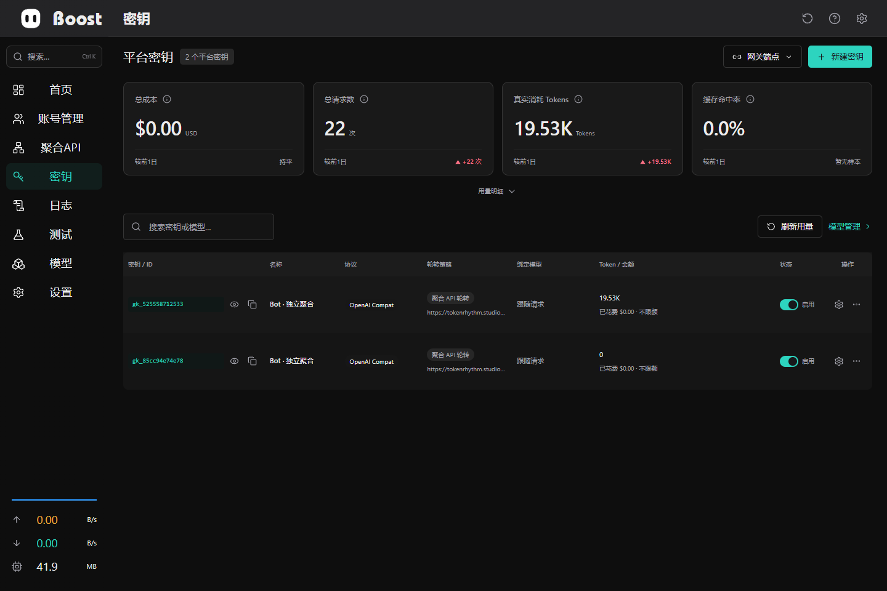
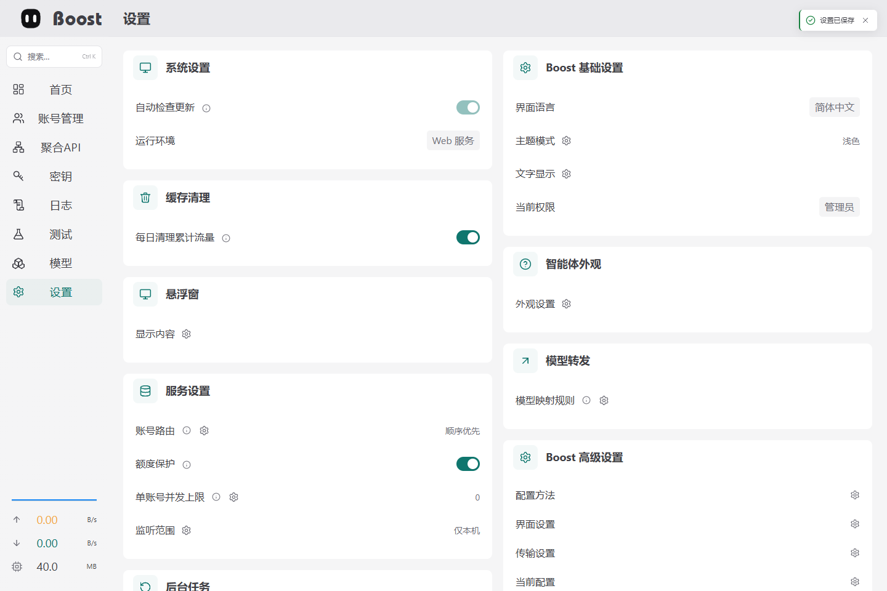
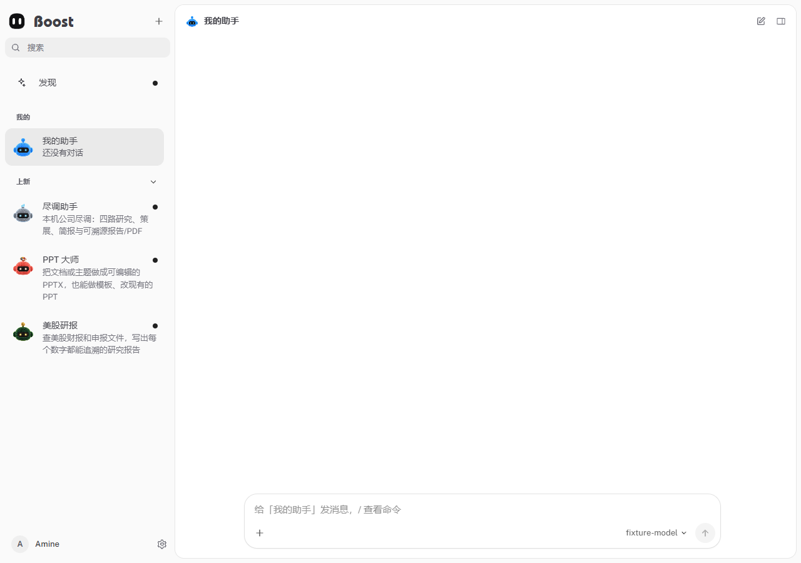

<p align="center">
  
</p>

<h1 align="center">Boost</h1>

<p align="center">A self-hosted AI account manager, compatible API gateway, and agent workspace.</p>

<p align="center"><a href="README.zh-CN.md">简体中文</a> · <a href="docs/README.md">Documentation</a> · <a href="SECURITY.md">Security</a> · <a href="https://github.com/amine123max/Boost-bot/releases">Releases</a></p>

<p align="center">
  
  
  
  
  
  
  
  <a href="https://github.com/amine123max/Boost-bot/releases/latest"></a>
  <a href="https://github.com/amine123max/Boost-bot/blob/main/LICENSE"></a>
</p>

Boost unifies AI accounts, model routing, API keys, usage monitoring, and an embedded agent workspace. Run it as a Tauri desktop application or a self-hosted Web console backed by the same Rust service.



## Releases

**[Download the latest release](https://github.com/amine123max/Boost-bot/releases/latest)** · [All releases](https://github.com/amine123max/Boost-bot/releases)

The Release badge reads the latest published version directly from GitHub. Version details and available downloads are maintained on the Releases page.

| Platform | Release format |
| --- | --- |
| Windows x64 | Desktop portable EXE (`Boost_0.5.0_x64.exe`) / NSIS installer (`-setup.exe`) |
| macOS Apple Silicon | Disk image (`.dmg`) |

These are the packaging targets defined by the release workflow. Download availability follows the published release.

## Features

| Area | Capabilities |
| --- | --- |
| Accounts | Import, authorization, availability checks, usage windows, and routing preferences. |
| API gateway | OpenAI-style Responses and Chat Completions, streaming, tools, model mapping, and aggregate upstreams. |
| Keys and models | Key ownership, access policies, quotas, model catalog, source routing, and pricing. |
| Operations | Request logs, telemetry, account tests, proxy-node measurements, and managed sing-box integration. |
| Bot workspace | Conversations, memory, tasks, approvals, messaging channels, and role-controlled tools. |
| Desktop and appearance | Tray integration, user-controlled updates, light/dark modes, and 17 accent colors. |

Protocol capabilities depend on the configured upstream and model. See the [documentation](docs/README.md) for deployment and authorization boundaries.

## Screenshots

The current interface is shown with isolated demonstration data; no production credentials are included.

<details>
<summary>Accounts, models, and platform keys</summary>



<br />

**Model workspace**



<br />

**Platform keys**



</details>

<details>
<summary>Theme settings and Bot workspace</summary>



<br />

**Bot workspace**



</details>

## Quick start

For a source build, install Node.js 22.13+ (24 LTS recommended), pnpm 10.30.3, and a current stable Rust toolchain. Run from the repository root:

```bash
pnpm -C frontend install --frozen-lockfile
node scripts/prepare-boost-bot.mjs
pnpm -C frontend run build:desktop
cargo build --locked -p boost-service -p boost-web -p boost-start
cargo run --locked -p boost-start
```

Open **[http://localhost:12000](http://localhost:12000)**. Both local use and hosted Web deployments use **port 12000** as the normal browser entry.

For desktop installers, Docker, development hot reload, and persistent storage, see the [build guide](docs/BUILDING.md).

Desktop user data, logs, runtimes and updates are organized under `~/.boost`; Windows/Linux WebView profiles use `~/.boost/cache/webview`. Upgrades migrate existing application data. See the [storage layout](docs/BUILDING.md#desktop-user-storage--桌面用户存储).

## Repository

| Directory | Responsibility |
| --- | --- |
| [`frontend/`](frontend/README.md) | Vue interface, typed API clients, and browser tests. |
| [`backend/`](backend/README.md) | Rust storage, service, Web gateway, launcher, and Tauri desktop shell. |
| [`bot/`](bot/README.md) | Agent runtime, Bot UI, channels, tasks, and built-in skills. |
| [`nginx/`](nginx/README.md) | Reverse-proxy configuration. |
| [`docker/`](docker/README.md) | Container builds and deployment. |
| [`scripts/`](scripts/README.md) | Development, packaging, and verification tools. |

## Documentation

[Architecture](ARCHITECTURE.md) · [Build and deployment](docs/BUILDING.md) · [Testing](TESTING.md) · [Contributing](CONTRIBUTING.md) · [Security](SECURITY.md)

## Star history

[](https://star-history.com/#amine123max/Boost-bot&Date)

## Linux DO community and acknowledgements

Boost is an independent open-source project shared with the [Linux DO](https://linux.do/) community. Community feedback and contributions are welcome. It is independently maintained and is not an official Linux DO project.

Thanks to [Linux DO](https://linux.do/) for providing a place for technical discussion and open-source sharing. Community members are welcome to help improve Boost.

## License

MIT. Preserve the [project license](LICENSE) and [third-party notices](bot/THIRD_PARTY_NOTICES.md) when redistributing.

The desktop API defaults to `http://localhost:12580/v1`; the Web management UI uses `http://localhost:12000`. Saved legacy local port 48760 migrates to 12580; explicit environment overrides and remote addresses are preserved. Closing the main window hides it and opens a standalone confirmation with Minimize, Exit and Remember my choice. Minimize shows the floating monitor while the service continues running; the default close behavior can be changed in System Settings. The compact monitor snaps to the top or either side, switches orientation, and returns to the main window on double-click. Settings → Floating monitor controls quota, task progress, TPS, upload, download and memory visibility; its size follows the selected items. Task monitoring supports the built-in Bot and local Codex, Claude Code and DeepSeek Harness logs. Missing estimates stay indeterminate and missing token-rate samples show “—”. Update sources are fixed at build time and cannot be overridden by historical runtime settings. Sidebar search supports Ctrl+K, page navigation and settings shortcuts with role filtering; 22px page headings align with the brand row.
