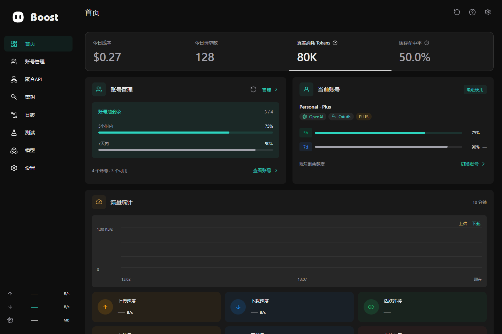
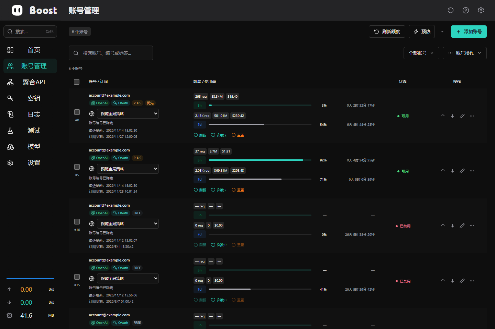
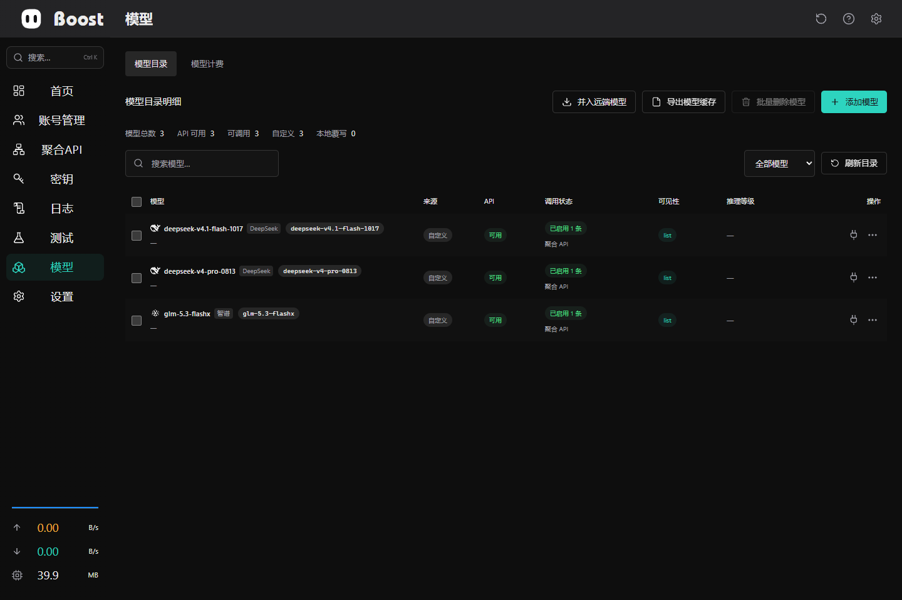
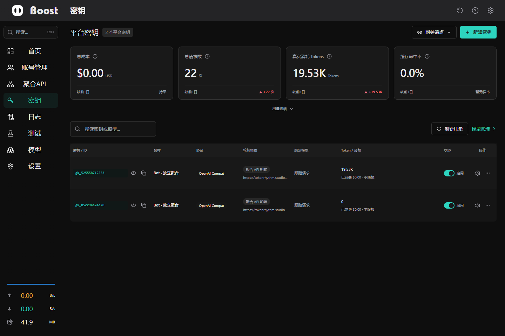
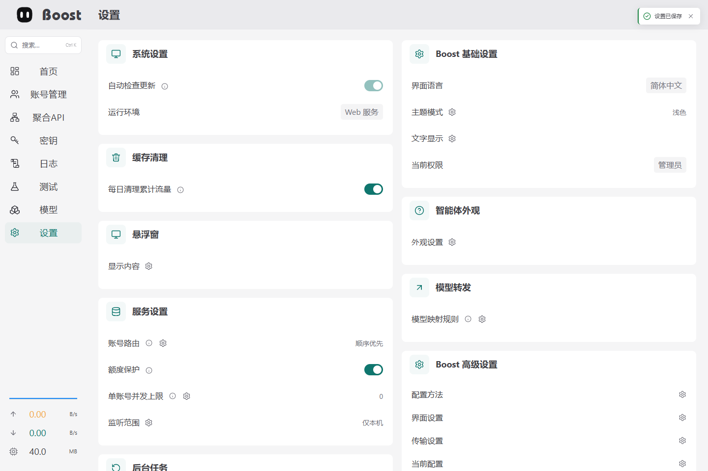
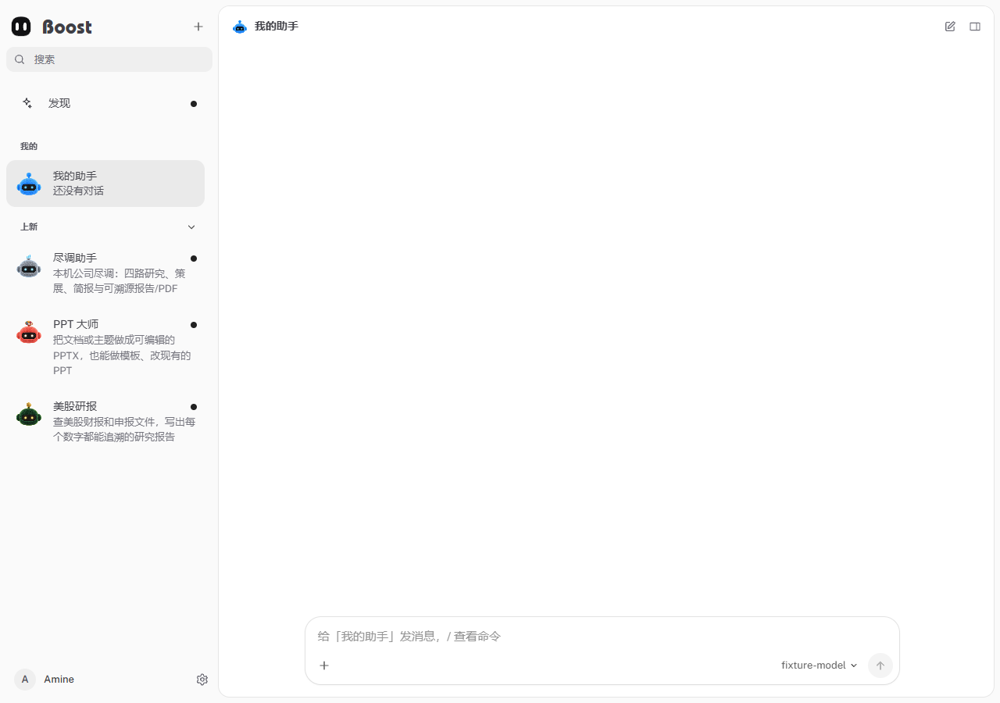

<p align="center">
  
</p>

<h1 align="center">Boost</h1>

<p align="center">面向自托管场景的 AI 账号管理、兼容 API 网关与智能体工作台。</p>

<p align="center"><a href="README.md">English</a> · <a href="docs/README.md">文档中心</a> · <a href="SECURITY.md">安全说明</a> · <a href="https://github.com/amine123max/Boost-bot/releases">发布版本</a></p>

<p align="center">
  
  
  
  
  
  
  
  <a href="https://github.com/amine123max/Boost-bot/releases/latest"></a>
  <a href="https://github.com/amine123max/Boost-bot/blob/main/LICENSE"></a>
</p>

Boost 将 AI 账号、模型路由、平台密钥、用量监控与内置智能体工作台集中管理。支持 Tauri 桌面应用与自托管 Web 控制台，两种模式共享 Rust 服务。



## 版本与下载

**[下载最新版本](https://github.com/amine123max/Boost-bot/releases/latest)** · [全部版本](https://github.com/amine123max/Boost-bot/releases)

顶部 Release 标签直接读取 GitHub 最新已发布版本，版本详情和可用安装包以 Releases 页面为准。

| 平台 | 发布格式 |
| --- | --- |
| Windows x64 | 桌面免安装 EXE（`Boost_0.5.0_x64.exe`）/ NSIS 安装程序（`-setup.exe`） |
| macOS Apple Silicon | 磁盘映像（`.dmg`） |

以上为发布工作流定义的打包目标，具体下载内容以已发布版本为准。

## 核心功能

| 领域 | 能力 |
| --- | --- |
| 账号管理 | 导入、授权、可用性检测、额度窗口与路由偏好。 |
| API 网关 | OpenAI 风格的 Responses、Chat Completions、流式响应、工具调用、模型映射与聚合上游。 |
| 密钥与模型 | 密钥归属、访问策略、额度限制、模型目录、来源路由与定价。 |
| 运行维护 | 请求日志、遥测、账号测试、代理节点测量与受管 sing-box 内核。 |
| Bot 工作台 | 对话、记忆、任务、审批、消息渠道与按角色控制的工具能力。 |
| 桌面与外观 | 系统托盘、由用户决定执行的更新、明暗主题及 17 种强调色。 |

协议能力取决于配置的上游和模型，部署与授权边界见[文档中心](docs/README.md)。

## 界面预览

截图展示当前界面，使用隔离的演示数据，不包含生产凭据。

<details>
<summary>账号、模型与平台密钥</summary>



**模型工作区**



**平台密钥**



<details>
<summary>主题设置与 Bot 工作台</summary>



**Bot 工作台**



## 快速开始

源码构建需要 Node.js 22.13+（推荐 24 LTS）、pnpm 10.30.3 和当前稳定版 Rust。在仓库根目录执行：

```bash
pnpm -C frontend install --frozen-lockfile
node scripts/prepare-boost-bot.mjs
pnpm -C frontend run build:desktop
cargo build --locked -p boost-service -p boost-web -p boost-start
cargo run --locked -p boost-start
```

打开 **[http://localhost:12000](http://localhost:12000)**。本地使用与部署后的 Web 均以 **12000** 为正常浏览器入口。

桌面打包、Docker、开发热更新及持久化配置见[构建指南](docs/BUILDING.md)。

## 项目结构

| 目录 | 职责 |
| --- | --- |
| [`frontend/`](frontend/README.zh-CN.md) | Vue 界面、类型化 API 和浏览器测试。 |
| [`backend/`](backend/README.zh-CN.md) | Rust 存储、服务、Web 网关、启动器和 Tauri 桌面壳。 |
| [`bot/`](bot/README.zh-CN.md) | 智能体运行时、Bot 界面、渠道、任务与内置技能。 |
| [`nginx/`](nginx/README.md) | 反向代理配置。 |
| [`docker/`](docker/README.md) | 容器构建与部署。 |
| [`scripts/`](scripts/README.md) | 开发、打包与验证工具。 |

## 开发文档

[架构说明](ARCHITECTURE.md) · [构建与部署](docs/BUILDING.md) · [测试](TESTING.md) · [贡献约定](CONTRIBUTING.md) · [安全说明](SECURITY.md)

## Star 增长曲线

[](https://star-history.com/#amine123max/Boost-bot&Date)

## Linux DO 社区致谢

Boost 是面向 [Linux DO](https://linux.do/) 社区分享与交流的独立开源项目，欢迎社区朋友体验、反馈问题和参与贡献。项目由独立开发者维护，非 Linux DO 官方项目。

感谢 [Linux DO](https://linux.do/) 提供技术交流与开源分享的平台，欢迎佬友们一起交流、完善 Boost。


## 许可

MIT。分发时请保留[项目许可](LICENSE)和[第三方声明](bot/THIRD_PARTY_NOTICES.md)。

桌面版用户数据、日志、运行时和更新统一放在 `~/.boost`，Windows/Linux 界面缓存位于 `.boost/cache/webview`；升级会迁移旧应用目录。详见[存储目录说明](docs/BUILDING.md#desktop-user-storage--桌面用户存储)。

桌面版 API 默认地址为 `http://localhost:12580/v1`，Web 管理界面为 `http://localhost:12000`。升级会将已保存的旧本机默认端口 48760 迁移到 12580；显式环境变量和远程地址保持优先。点击主窗口关闭按钮时，先隐藏主窗口，再显示独立确认窗，提供“最小化”和“退出”两个操作并可记住选择；最小化会显示悬浮窗并继续运行服务，默认关闭行为可在系统设置中修改。悬浮窗拖动后吸附顶部或左右侧边，顶部横向、侧边竖向，双击返回主窗口。设置 → 悬浮窗可独立选择余量环、进度环、TPS 环及上传、下载和内存数据，窗口随显示内容收缩。任务监测支持内置 Bot 与本机 Codex、Claude Code、DeepSeek Harness；无可靠进度或速率采样时显示不定进度或“—”。更新来源由构建时仓库确定，历史运行时配置不能覆盖。 左侧搜索支持 Ctrl+K、页面导航与设置直达，并按权限过滤结果；顶部页面标题为 22px，与品牌同高。
