<p align="center"></p>

<h1 align="center">Boost</h1>

<p align="center">面向自托管场景的 AI 账号管理、兼容模型网关与智能体工作台。</p>

<p align="center"><a href="README.md">English</a> · <a href="docs/README.md">文档中心</a> · <a href="SECURITY.md">安全说明</a> · <a href="https://github.com/amine123max/Boost-bot/releases">发布版本</a></p>

<p align="center">
  
  
  
  
  
  
  
</p>

Boost 面向需要统一管理 AI 账号、接入多个模型来源并运行智能体的桌面与自托管用户。项目将 Rust 网关、Vue 管理界面与内置 Node.js Bot 运行时组合交付，以 SQLite 持久化，并在桌面与 Web 模式下共用服务端授权策略。

[](https://github.com/amine123max/Boost-bot/actions/workflows/release-all.yml)
[](https://github.com/amine123max/Boost-bot/releases/latest)
[](LICENSE)

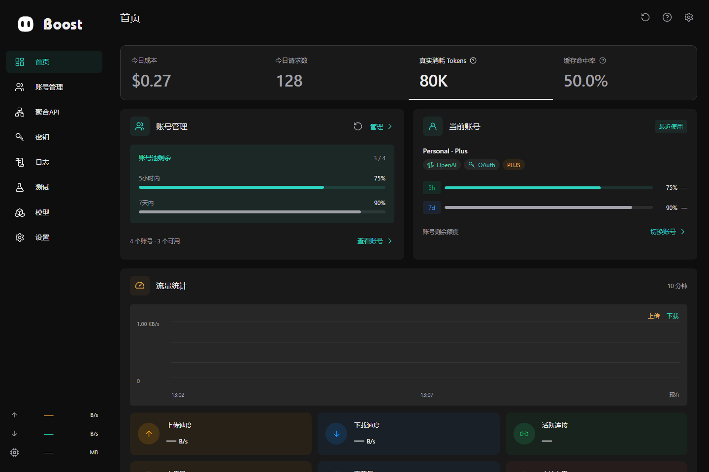

## Linux DO 社区致谢

Boost 是面向 [Linux DO](https://linux.do/) 社区分享与交流的独立开源项目，欢迎社区朋友体验、反馈问题和参与贡献。项目由独立开发者维护，非 Linux DO 官方项目。

感谢 Linux DO 提供技术交流与开源分享的平台。

## 版本与下载

**[下载最新 Release](https://github.com/amine123max/Boost-bot/releases/latest)** · [历史版本与发布说明](https://github.com/amine123max/Boost-bot/releases)

| 平台 | 安装包 |
| --- | --- |
| Windows x64 | [最新 Release](https://github.com/amine123max/Boost-bot/releases/latest)中的免安装 EXE 与 NSIS 安装程序 |
| macOS Apple Silicon | [最新 Release](https://github.com/amine123max/Boost-bot/releases/latest)中的 DMG |
| 完整性 | [最新 SHA-256 校验清单](https://github.com/amine123max/Boost-bot/releases/latest/download/SHA256SUMS.txt) |

## 核心能力

| 领域 | 技术范围 |
| --- | --- |
| 账号管理 | 授权、导入、可用性检测与额度窗口 |
| 模型网关 | Responses / Chat Completions、JSON / SSE、工具调用、来源映射与故障切换 |
| 访问与计量 | 密钥归属、模型权限、Token 预算、速率/并发准入和幂等结算 |
| 智能体工作台 | 对话、任务、审批、工具与签名消息渠道 |
| 运行维护 | 来源熔断、请求诊断、有界队列、上游代理、受管 sing-box 与原生监控 |

协议能力取决于上游支持。主库 SQLCipher 和每身份 Bot 加密显式启用，工作文件/日志不属于数据库加密范围；技术边界与验证见[系统架构](ARCHITECTURE.zh-CN.md)。

## 技术架构

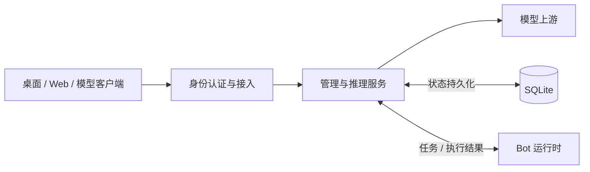

Web 直接入口为 **12000**。桌面版管理本机 Rust/Node 运行时，不依赖 Nginx 或 FastAPI。RPC 资源预算、身份边界、持久化与流式代理详见[系统架构](ARCHITECTURE.zh-CN.md)。

| 技术层 | 职责 |
| --- | --- |
| Vue 3 / TypeScript / Vite | 类型化客户端、桌面/Web 共用界面、静态路由产物 |
| Tauri 2 / Rust | 原生 IPC、窗口/托盘、本地服务生命周期与桌面更新 |
| Axum / Tokio / tiny_http | 会话网关、JSON-RPC 分发、有界管理准入与 HTTP 兼容 |
| reqwest / 协议适配器 | 模型路由、HTTP JSON、SSE、受支持的 WebSocket 与工具调用转换 |
| SQLite / SQLCipher / Node 原生驱动 | 主库与按身份隔离的 Bot 数据、WAL、校验转换和独立密钥派生 |
| Nginx / FastAPI | 可选 TLS 入口、受权转发、流式保真与 Bot 有界准入 |
| Node.js / DSH / sing-box | 有状态智能体与工具执行、可选受管上游网络出口 |

| 资源边界 | 默认策略 |
| --- | --- |
| 管理 RPC | 6 个写执行位、有界资源队列、16 个读许可和跨领域屏障 |
| 推理 | 20 QPS、突发 20、全局 24 / 每模型 8 在途，为管理保留存储余量 |
| 输入内存 | 单体 32 MiB、推理输入缓冲 64 MiB，前置代理背压转发 |
| 上游故障 | 按来源隔离熔断、有界半开探测和健康来源切换 |
| 数据保护 | 显式 SQLCipher 主库、每身份 Bot 派生密钥、错密钥拒绝启动 |
| 发布 | Ed25519 清单绑定 tag、源提交、平台和 SHA-256 |

上述预算以进程为边界，实际容量与延迟受硬件、负载及上游影响，见[负载验证](docs/PERFORMANCE.zh-CN.md)。

## 界面预览

**账号管理**

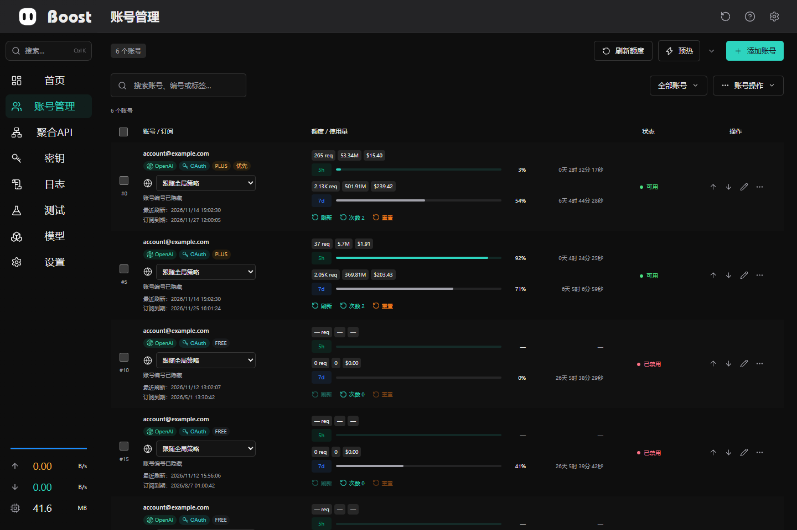

<br />

**模型工作区**

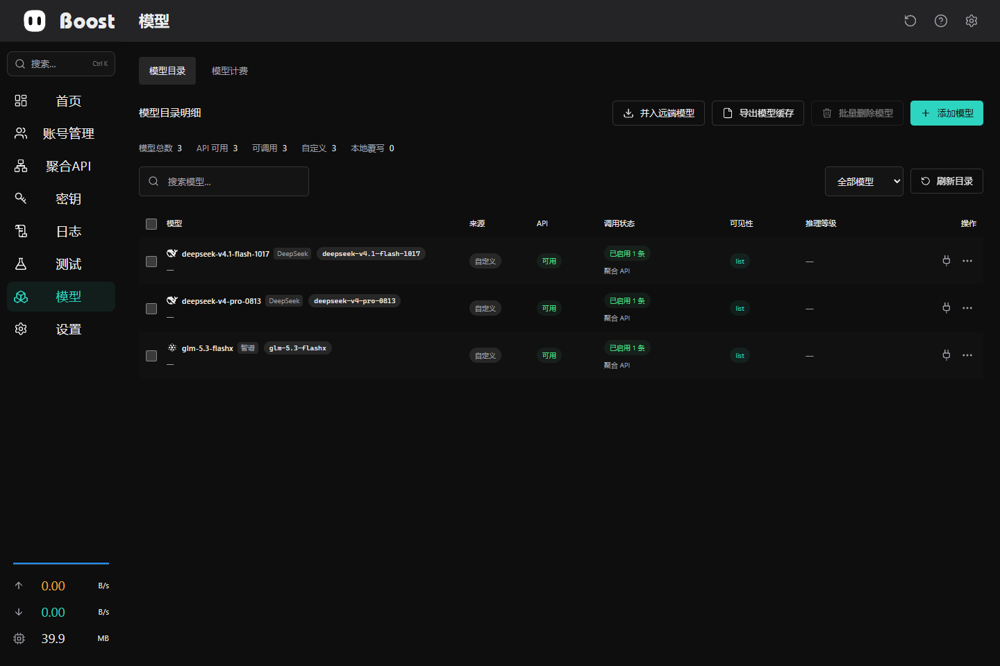

<br />

**平台密钥**

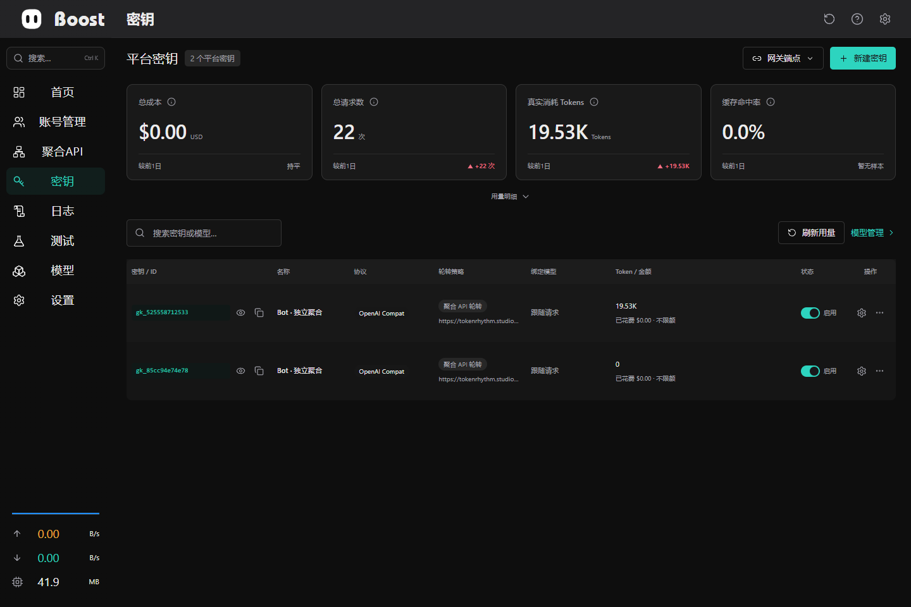

<br />

**Bot 工作台**


<br />

**智能体库**

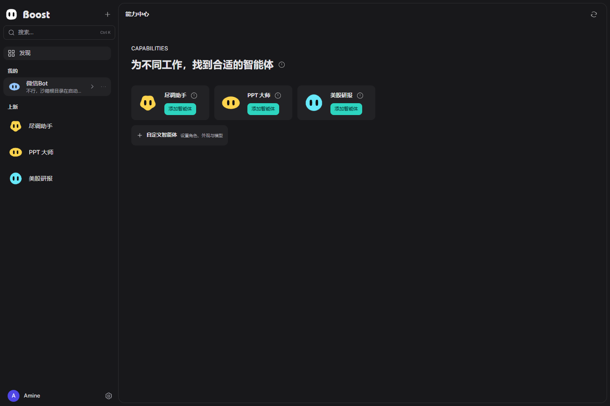

<br />

**Bot 模型来源**

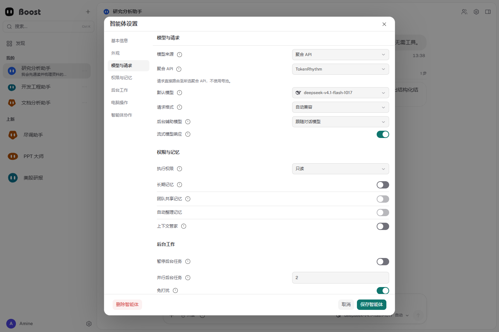

<br />

**Bot 设置**

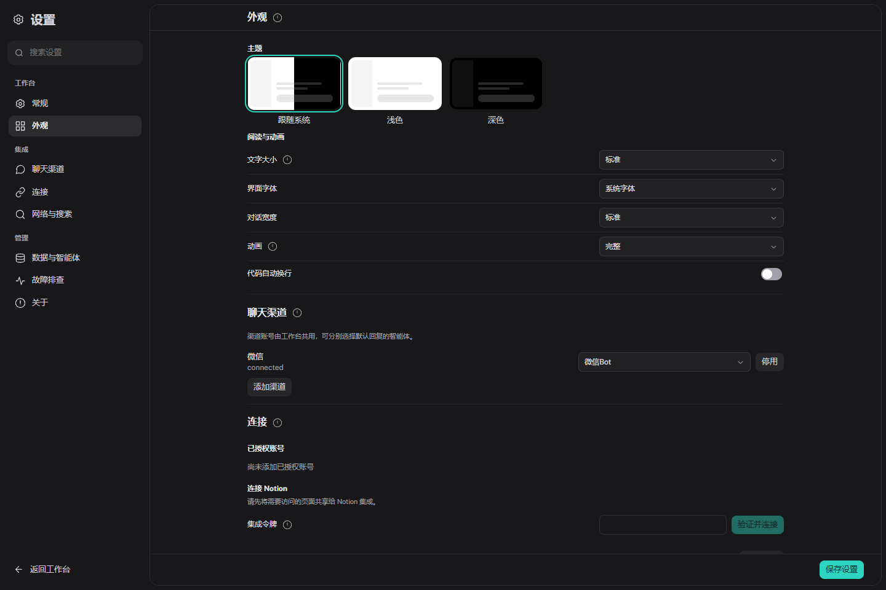

<br />

**Bot 存储**

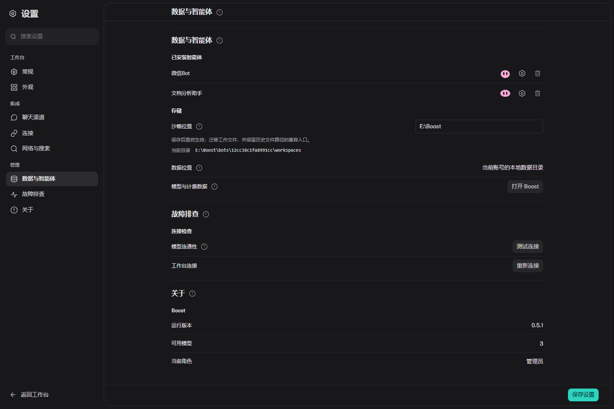

<br />

**任务、渠道与审批**


<br />

**外观设置**

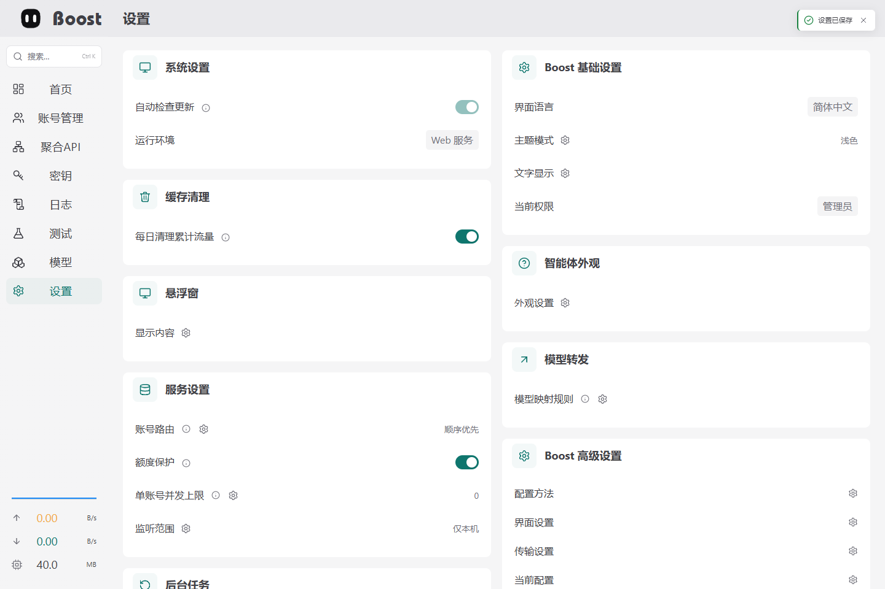

<br />

**网关设置**

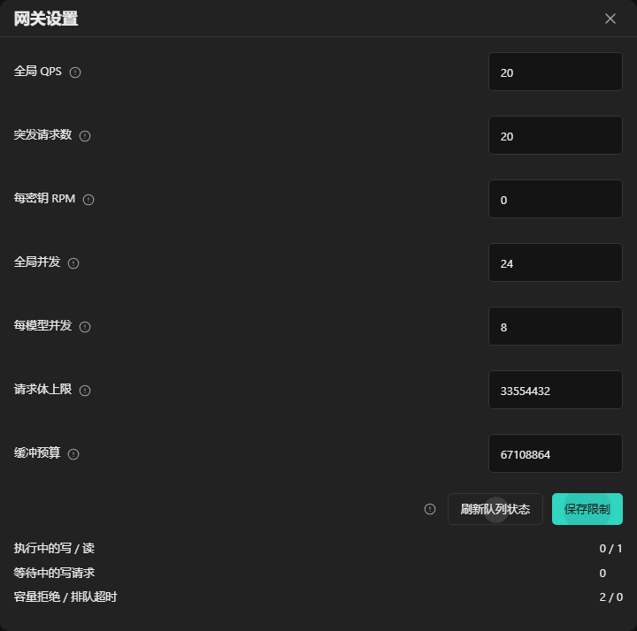

<br />

**存储安全**

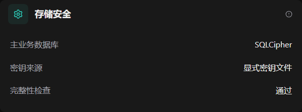

<br />

截图使用隔离的演示数据，[界面图集](docs/SCREENSHOTS.zh-CN.md)按子系统组织。

## 快速开始

**前置条件：** Node.js 22.13+（推荐 24 LTS）、pnpm 10.30.3、稳定版 Rust 与原生 C/C++ 工具链。[系统依赖](docs/BUILDING.md#platform-dependencies--系统依赖)按平台列出。

**安装与构建：**

```sh
git clone https://github.com/amine123max/Boost-bot.git
cd Boost-bot
npm install --global npm@11.6.2
pnpm -C frontend install --frozen-lockfile
node scripts/prepare-boost-bot.mjs
pnpm -C frontend run build:desktop
cargo build --locked -p boost-service -p boost-web -p boost-start
```

**启动：**

```sh
cargo run --locked -p boost-start
```

**验证：** 打开 [http://localhost:12000](http://localhost:12000)，应显示管理界面或登录页。该步骤验证应用启动；模型调用还需配置上游和平台密钥。[桌面打包与 Docker](docs/BUILDING.md)另有说明。

## 配置与文档

| 主题 | 入口 |
| --- | --- |
| 运行配置与环境示例 | [配置参考](docs/CONFIGURATION.zh-CN.md) · [.env.example](.env.example) |
| 组件、RPC、Nginx 与持久化 | [系统架构](ARCHITECTURE.zh-CN.md) |
| 构建、存储与部署 | [构建指南](docs/BUILDING.md) · [Docker](docker/README.md) · [Nginx](nginx/README.md) |
| 智能体与渠道集成 | [Bot](bot/README.zh-CN.md) · [集成说明](bot/INTEGRATION.md) |
| 用量与诊断 | [用量统计](docs/USAGE.md) · [运行手册](docs/README.md) |
| 界面截图 | [界面图集](docs/SCREENSHOTS.zh-CN.md) |

## 贡献与安全

开发流程见[贡献约定](CONTRIBUTING.md)，验证命令见[测试说明](TESTING.md)，漏洞报告见[安全说明](SECURITY.md)。发布任务定义于[发布工作流](.github/workflows/release-all.yml)；状态徽章表示发布构建结果，不代表另有 PR 自动测试流水线。

## 许可

采用 [MIT 许可](LICENSE)，分发时保留[第三方声明](bot/THIRD_PARTY_NOTICES.md)。

[](https://star-history.com/#amine123max/Boost-bot&Date)
