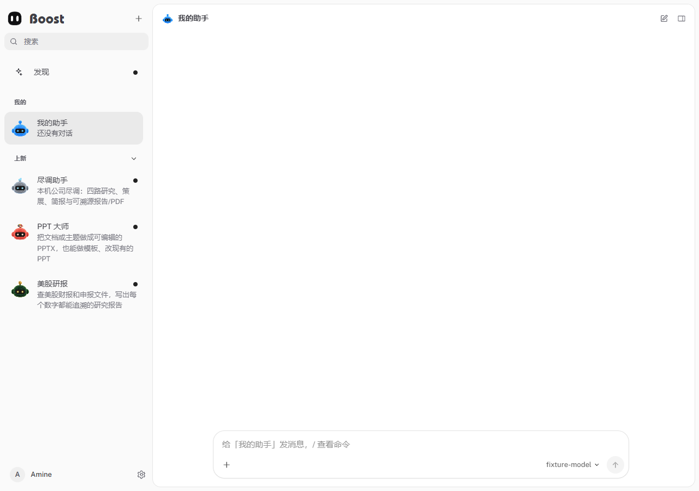

# Boost Bot

[简体中文](README.zh-CN.md) · [Project](../README.md) · [Integration](INTEGRATION.md)

Boost Bot is the hosted agent workspace: conversations, memory, tasks, approvals, messaging channels, file delivery and specialist bots. Boost supplies authentication and model routing through the existing gateway.



## Components

| Directory | Responsibility |
| --- | --- |
| `src/` | Node.js host, conversations, channels, task scheduling and tool orchestration |
| `ui/` | Preact browser workspace |
| `dsh-runtime/` | Tool-runtime dependencies and bridge plugins |
| `bots/` | Built-in specialist bots, personas and runtime skills |
| `shared/appearance/` | Avatar implementation shared with the Vue frontend |
| `test/` | Unit, integration and offline host regressions |

Skill Markdown and templates under `bots/` are runtime resources, not general repository documentation.

## Prepare and build

From the repository root, with Node.js 22.13+:

```bash
node scripts/prepare-boost-bot.mjs
npm --prefix bot run build
```

The preparation script installs locked dependencies when needed, builds the host and shared appearance modules, and stages Node plus platform-specific tools. The Tauri build hook runs the same preparation. For a service distribution:

```bash
node scripts/stage-boost-bot.mjs <package-directory>
```

Keep the staged `boost-bot/` beside the service binaries, including its dependencies, UI, skills and license notices. Tool binaries must match the target OS and CPU architecture.

## Runtime contract

- The service starts actor-scoped hosts and supplies an existing authorized platform key through stdin; browsers do not receive model secrets.
- Web pages, static resources, downloads and SSE pass through authenticated Boost Web. The normal application entry is **12580**.
- Member sessions can chat in their own scope; server tools, task mutations, channel credentials and system configuration require administrator authority.
- Messaging channels require real platform credentials. Computer control also depends on host system permissions and a usable graphical session.
- `BOOST_BOT_ROOT` locates the prepared runtime; `BOOST_BOT_NODE` selects Node. Optional signed catalogs use `BOOST_BOT_CATALOG_URL` and `BOOST_BOT_CATALOG_PUBKEY` together.

See [integration boundaries](INTEGRATION.md) and [runtime configuration](../docs/en/report/environment-and-runtime-config.md).

## Verification

```bash
npm --prefix bot run build
node bot/scripts/smoke-host.mjs --browser
npm --prefix bot test -- test/boost-integration.test.ts test/e2e.test.ts test/tasks.unit.test.ts test/rules.unit.test.ts test/channel-accounts.e2e.test.ts
```

The host smoke uses an isolated local model fixture. Configure task-local temporary storage as described in [TESTING.md](../TESTING.md). Preserve [LICENSE](LICENSE), [third-party notices](THIRD_PARTY_NOTICES.md) and [additional licenses](LICENSES/).
