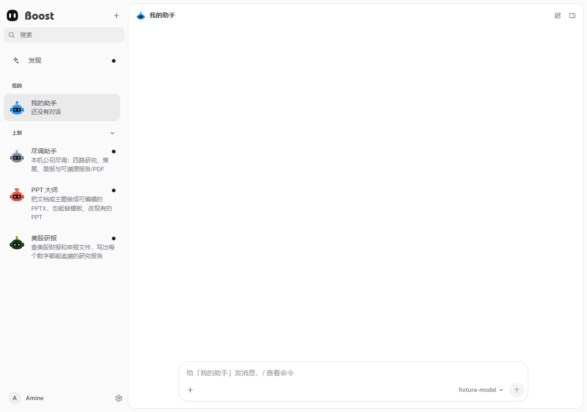
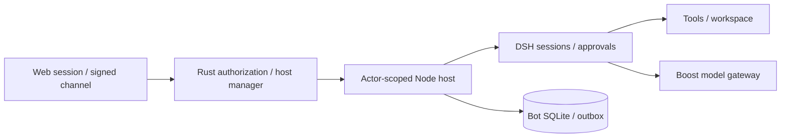
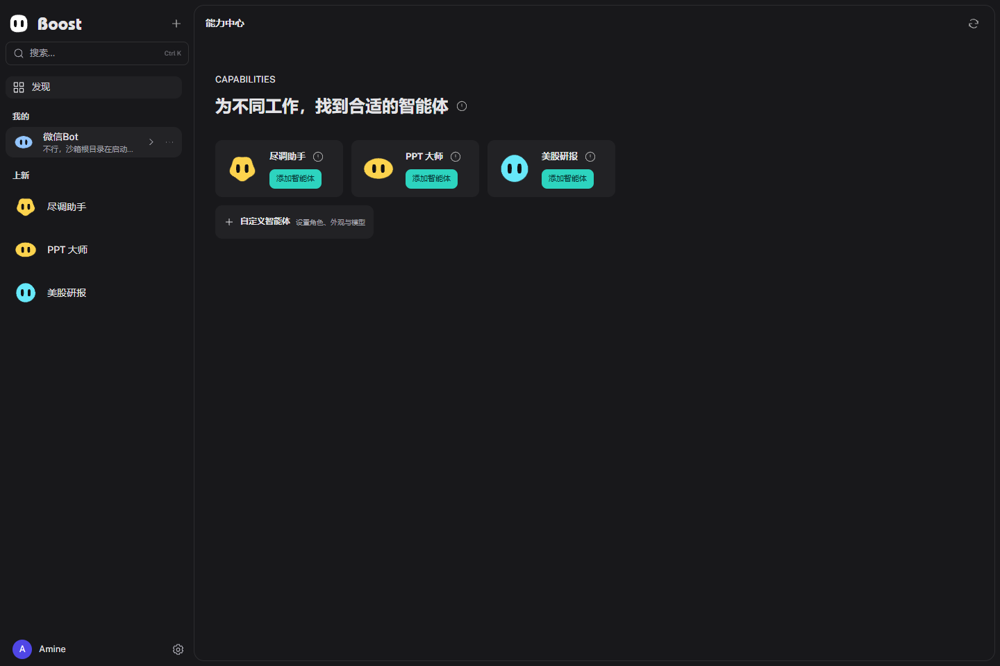
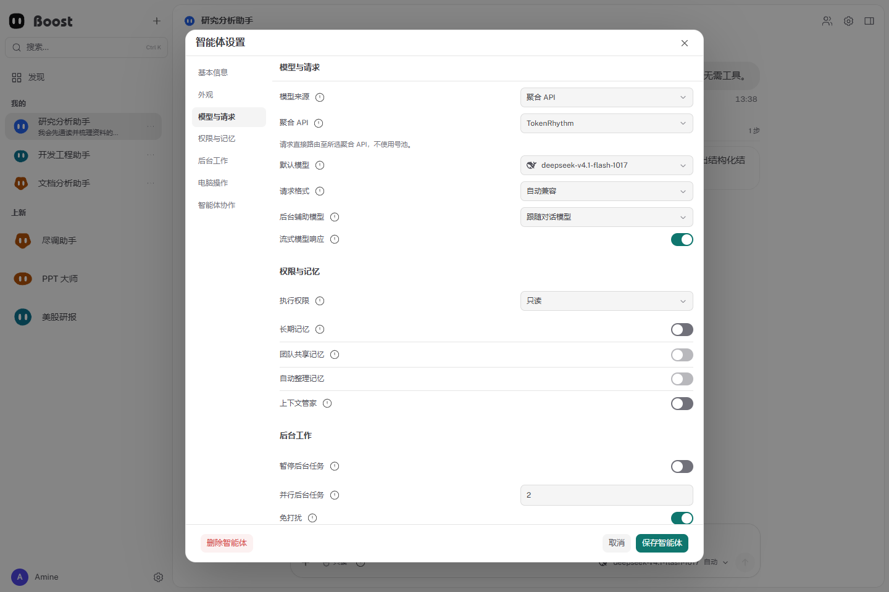
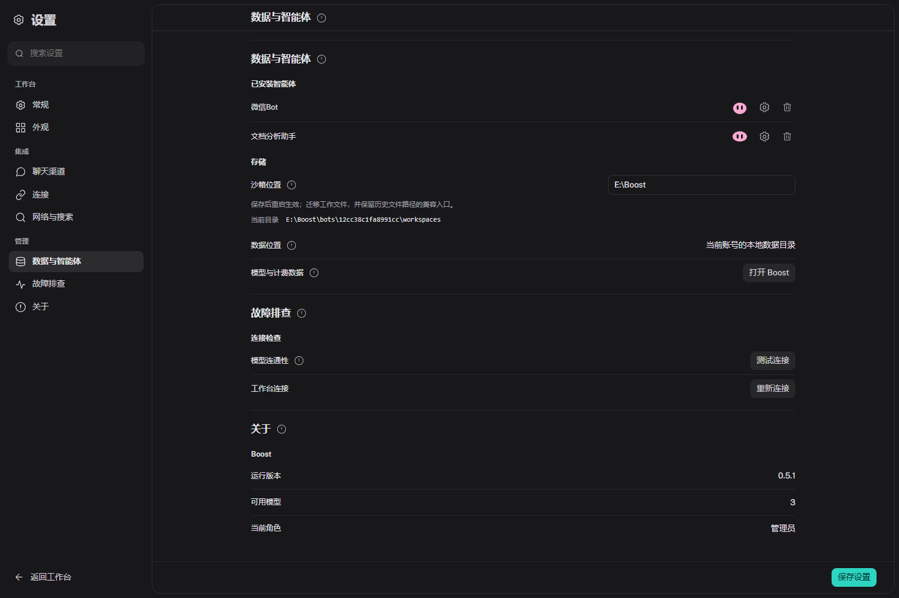

# Boost Bot

[简体中文](README.zh-CN.md) · [Project](../README.md) · [Runtime integration](INTEGRATION.md)

Boost Bot is the managed agent workspace for conversations, tasks, approvals, messaging channels and file delivery. Boost owns authentication, model access and billing; the embedded Node runtime owns stateful agent execution.



## Runtime architecture



Desktop uses managed loopback processes. Self-hosted deployments may add [FastAPI](backend/api/README.md) and [Nginx](../nginx/README.md); those layers preserve the existing Web authorization chain.

## Components

| Location | Technology / responsibility |
| --- | --- |
| `backend/src/` | TypeScript agent runtime, persistence, tools, channels and host bootstrap |
| `frontend/src/` | Vue 3 Bot workspace and specialist previews |
| `shared/` | Shared protocol, state and appearance types |
| `dsh-runtime/` | Locked DSH dependency and agent execution resources |
| `bots/` | Built-in personas, tools, skills and templates |
| `assets/`, `bin/` | Packaged assets, Node and native tools |
| `backend/api/` | Optional Python FastAPI ingress |
| `dist/` | Generated runtime/UI output |

## Identity, model access and storage

Each trusted actor has its own managed host and data scope. Web derives that actor from its session; public callers cannot supply internal RPC credentials or arbitrary actor headers. Model calls use an owned platform key and remain subject to model groups, source mapping, quotas and wallet policy.

Per-Bot source bindings select account-pool or aggregate connections from authorized options. Remote discovery and manual mappings remain source-specific. An aggregate model must not become an account-pool route merely because its name appears in the global catalog.

Bot persistence remains SQLite. The encryption-capable Node binding stores conversations, channels, memory, approvals and durable outbound state. When main storage encryption is enabled, an independent per-actor key is derived and passed through the private bootstrap pipe; an existing Bot database converts on its next host start. Workspace files and logs are outside database encryption.

Data and workspace locations can be changed separately. Paths refer to the host running Boost, require restart, reject target conflicts and retain historical path compatibility. See [storage and workspaces](../docs/en/report/bot-storage-and-workspaces.md).

## Execution and collaboration

| Area | Contract |
| --- | --- |
| Conversations | Stream public text, reconnect to active replies, and manage queued messages above the composer |
| Tasks | Use `/task` in single chat to create a real scheduled task and track it above the composer |
| Approvals | Preserve per-Bot permissions; answer Web questions above the composer |
| Memory/context | Separate measured usage from estimates and missing categories |
| Groups/handoffs | Actor-local membership, explicit delivery and scoped workspace access |
| File delivery | Durable outbox for final replies, files and important notifications |
| Specialist previews | Company Research, PPT Master and US Stock Research; browsing does not implicitly install an instance |

Tool permissions, application approvals and workspace restrictions do not themselves constitute a complete OS sandbox. Token/time budgets and platform isolation must be verified at the execution boundary.

## Channels

WeChat, Feishu, Telegram, Slack, Discord, DingTalk, QQ and signed custom HTTP bridges use independent channel-account credentials. Platform login and concurrent-session limits still apply. DingTalk uses Stream; QQ uses signed HTTPS callbacks. Custom bridges require a verified challenge and byte-level HMAC.

Inbound deduplication, sender permissions and outbound idempotency remain separate mechanisms. Never give a bridge the internal Boost RPC credential. See [custom channel protocol](CUSTOM_CHANNEL.md) and [Nginx callbacks](../nginx/README.md).

## Interface evidence

**Bot library**



<br />

**Source configuration**



<br />

**Storage settings**



Images use isolated demonstration data. TPS uses reported usage and measured elapsed time; if usage arrives only at completion, it represents a request average. Estimated task progress is labelled by its source and does not become measured provider throughput.

## Build and validation

Node.js 22.13+ is required; use the target OS/architecture and Node ABI for native SQLite and tools.

```sh
node scripts/prepare-boost-bot.mjs
npm --prefix bot run build
```

Run from the repository root. Preparation uses locked dependencies, validates native SQLite and stages required tools/notices. [Build guide](../docs/BUILDING.md) covers service and desktop packaging.

Validate real authorized login, streaming, stop, persisted history, channel signatures, file delivery, groups, isolation and overload against a running Boost instance. A fixture test or build alone is not evidence of real model/channel compatibility. Follow [validation requirements](../TESTING.md).
