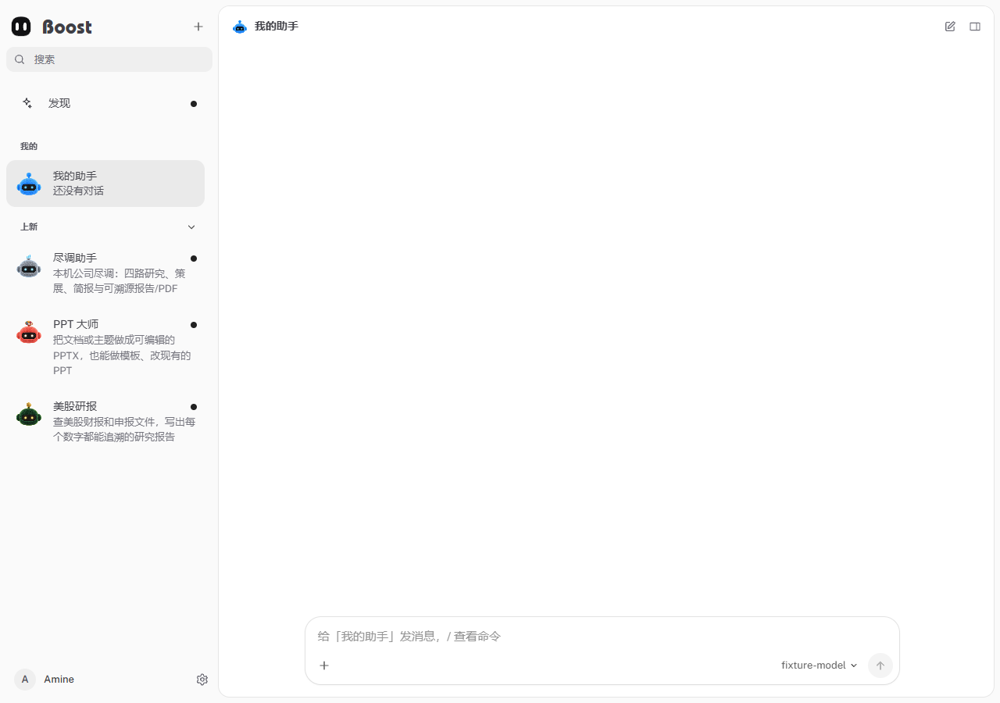

# Boost Bot

[English](README.md) · [项目首页](../README.zh-CN.md) · [集成边界](INTEGRATION.md)

Boost Bot 提供受管智能体工作台，包含对话、记忆、任务、审批、消息渠道、文件交付及专用 Bot。身份认证和模型路由由 Boost 现有网关提供。

尽调助手、PPT 大师和美股研报提供可交互的功能演示，仅预览不会安装智能体。点击 **与智能体对话** 可创建或打开对应会话，支持历史记录、流式回复与停止生成；点击 **返回工作台** 可回到专属界面。工作台输入区与完整对话页共用同一会话。



## 组成

| 目录 | 职责 |
| --- | --- |
| `src/` | Node.js 宿主、对话、渠道、任务调度和工具编排 |
| `ui/` | Preact 浏览器工作台 |
| `dsh-runtime/` | 工具运行时依赖与桥接插件 |
| `bots/` | 内置专用 Bot、角色定义及运行时技能 |
| `shared/appearance/` | 与 Vue 前端共用的头像实现 |
| `test/` | 单元、集成及离线宿主回归 |

`bots/` 中的技能 Markdown 与模板属于运行时资源，不能作为普通说明文档清理。

## 准备与构建

使用 Node.js 22.13+，从仓库根目录执行：

```bash
node scripts/prepare-boost-bot.mjs
npm --prefix bot run build
```

准备脚本按需安装锁定依赖、构建宿主与共享外观模块，并准备 Node 和当前平台工具。Tauri 构建钩子复用相同流程。独立服务分发时执行：

```bash
node scripts/stage-boost-bot.mjs <package-directory>
```

将输出的 `boost-bot/` 与服务可执行文件放在同级，保留运行依赖、界面、技能与许可。工具二进制必须匹配目标系统和 CPU 架构。

## 运行约定

- 服务按身份启动隔离宿主，通过 stdin 提供已有且有权使用的平台密钥，浏览器不接收模型秘密。
- Web 页面、静态资源、下载与 SSE 均经过 Boost Web 鉴权；正常应用入口为 **12000**。
- 成员只能在自身空间对话；服务器工具、任务修改、渠道凭据与系统配置需要管理员权限。
- 消息渠道需要真实平台凭据；电脑控制还取决于宿主系统权限与可用图形会话。
- `BOOST_BOT_ROOT` 指定准备后的运行目录，`BOOST_BOT_NODE` 指定 Node；额外签名目录使用 `BOOST_BOT_CATALOG_URL` 和 `BOOST_BOT_CATALOG_PUBKEY` 配对配置。

详见[集成边界](INTEGRATION.md)与[运行配置](../docs/zh-CN/report/环境变量与运行配置说明.md)。

## 验证

```bash
npm --prefix bot run build
npm --prefix bot run test:botkit
node bot/scripts/smoke-host.mjs --browser
node scripts/verify-bot-preview.mjs
npm --prefix bot test -- test/boost-integration.test.ts test/e2e.test.ts test/tasks.unit.test.ts test/rules.unit.test.ts test/channel-accounts.e2e.test.ts
```

宿主冒烟使用隔离的本地模型测试端点。按[测试说明](../TESTING.md)配置项目内临时目录。分发时保留[许可](LICENSE)、[第三方声明](THIRD_PARTY_NOTICES.md)和[附加许可](LICENSES/)。
