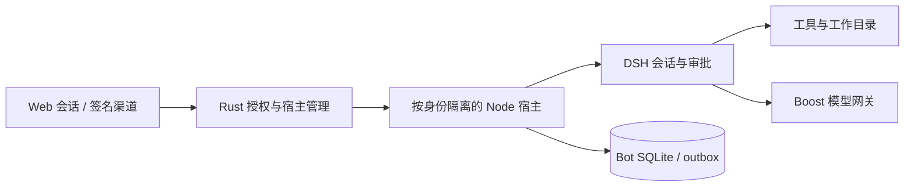
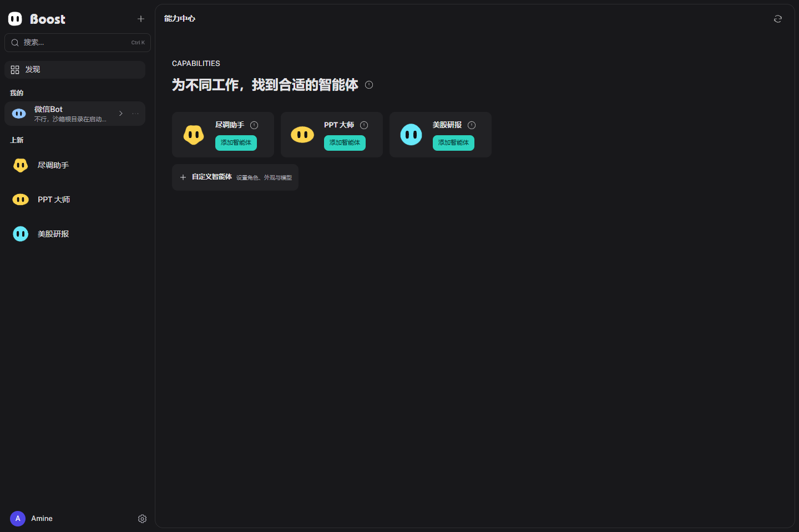
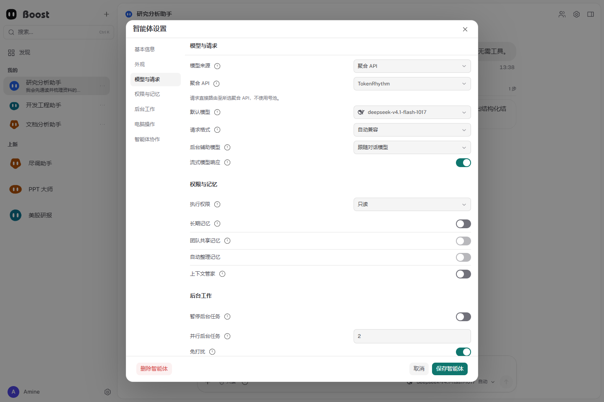
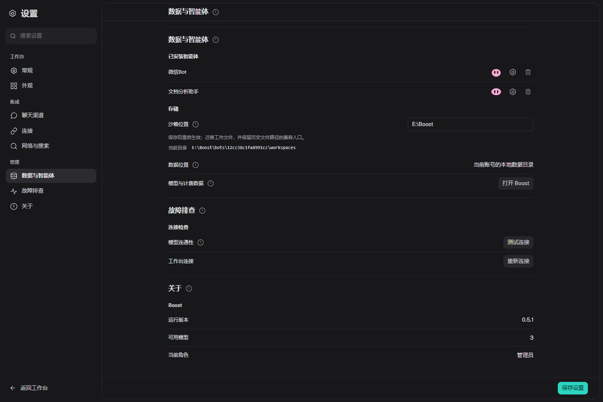

# Boost Bot

[English](README.md) · [项目首页](../README.zh-CN.md) · [运行时集成](INTEGRATION.zh-CN.md)

Boost Bot 提供受管智能体工作台，覆盖会话、任务、审批、消息渠道与文件交付。Boost 负责认证、模型权限和计费，内置 Node 运行时负责有状态智能体执行。


## 运行架构



桌面使用受管 loopback 进程；自托管部署可增加 [FastAPI](backend/api/README.zh-CN.md) 和 [Nginx](../nginx/README.zh-CN.md)，仍沿用 Web 鉴权链。

## 组成

| 目录 | 技术与责任 |
| --- | --- |
| `backend/src/` | TypeScript 智能体、存储、工具、渠道和宿主启动 |
| `frontend/src/` | Vue 3 工作台和专用预览 |
| `shared/` | 共享协议、状态和外观类型 |
| `dsh-runtime/` | 锁定的 DSH 依赖与执行资源 |
| `bots/` | 内置 persona、工具、技能与模板 |
| `assets/`、`bin/` | 打包资产、Node 与原生工具 |
| `backend/api/` | 可选 Python FastAPI 入口 |
| `dist/` | 构建生成的运行时和 UI |

## 身份、模型与存储

每个可信 actor 拥有独立受管宿主和数据范围。Web 从会话推导身份，公共调用者不能传入内部 RPC 凭据或任意 actor。模型调用通过有归属的平台 key，继续受模型组、来源映射、配额和钱包限制。

每个 Bot 可从有权限的账号池或聚合连接中选择来源；远端发现及手动映射保持来源隔离。模型名称出现在全局目录不代表它可通过账号池调用。

Bot 仍使用 SQLite；支持加密的 Node 驱动保存会话、渠道、记忆、审批和持久出站状态。主库启用加密后，按身份派生独立密钥并经私有启动管道传入；既有 Bot 库在对应宿主下次启动时转换。工作文件和日志不属于数据库加密范围。

数据位置与工作目录分别设置，路径指运行 Boost 的主机，重启后应用；拒绝目标冲突并保留历史路径兼容。详见[存储与工作目录](../docs/zh-CN/report/Bot沙箱与目录管理.md)。

## 执行与协作

| 领域 | 约定 |
| --- | --- |
| 会话 | 流式展示正文，刷新后可重接，在输入框上方管理待发消息 |
| 任务 | 单聊输入 `/task` 创建持久任务，在输入框上方跟踪 |
| 审批 | 保留每个 Bot 的权限；网页提问在输入框上方作答 |
| 记忆/上下文 | 区分实测、估算和缺失分类 |
| 群协作/交付 | 身份内成员关系、显式交付和工作目录校验 |
| 文件发送 | 最终回复、文件和重要通知使用持久 outbox |
| 专用预览 | Company Research、PPT Master、US Stock Research；浏览不自动安装实例 |

工具权限、审批和目录限制本身不是完整 OS 沙箱；Token/时间预算及平台隔离须在实际执行边界验收。

## 渠道

微信、飞书、Telegram、Slack、Discord、钉钉、QQ 和自定义签名 HTTP 桥使用独立账号凭据，仍受平台登录及会话并发限制。钉钉使用 Stream，QQ 使用签名 HTTPS 回调，自定义桥接须通过 challenge 和原始字节 HMAC。

入站去重、发送者权限、出站幂等分别治理。桥接方不持有内部 Boost RPC 凭据。参见[自定义渠道](CUSTOM_CHANNEL.zh-CN.md)与 [Nginx 回调](../nginx/README.zh-CN.md)。

## 界面证据

**智能体库**



<br />

**模型来源**



<br />

**存储设置**



截图使用隔离演示数据。TPS 来源于上报用量和实际耗时；上游仅结束时报告 usage 时只能得到请求均速。估算任务进度保留来源，不作为模型实测速率。

## 构建与验证

需要 Node.js 22.13+，原生 SQLite 和工具必须匹配目标 OS、架构及 Node ABI。

```sh
node scripts/prepare-boost-bot.mjs
npm --prefix bot run build
```

从仓库根目录执行。准备脚本采用锁定依赖、验证原生 SQLite，并保留工具许可。[构建指南](../docs/BUILDING.zh-CN.md)覆盖服务和桌面打包。

在运行的 Boost 中验证真实受权登录、流式、停止、历史、渠道签名、文件发送、群协作、身份隔离和过载。mock 或构建通过不代表真实模型/渠道兼容，按[验证要求](../TESTING.zh-CN.md)记录证据。
