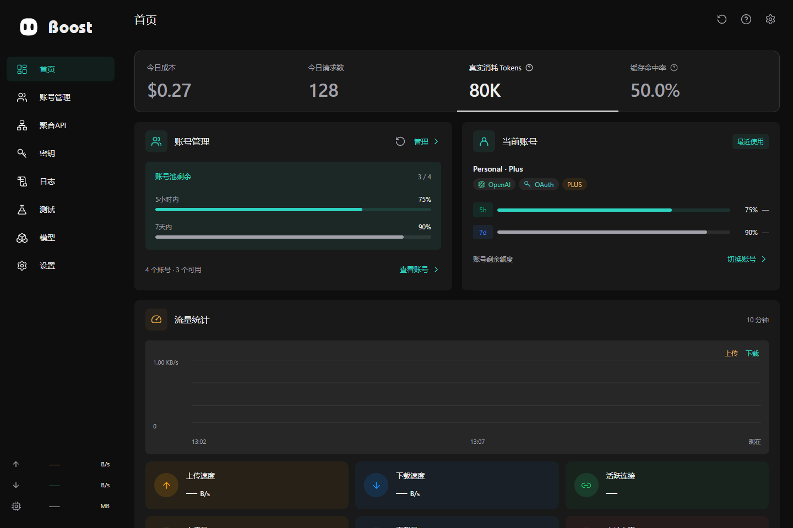
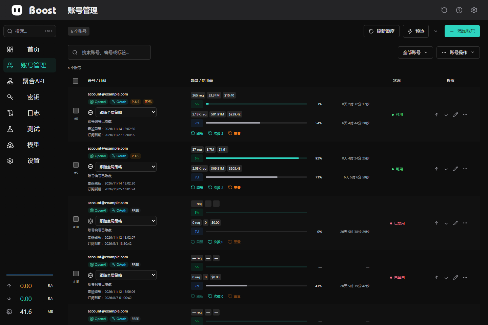
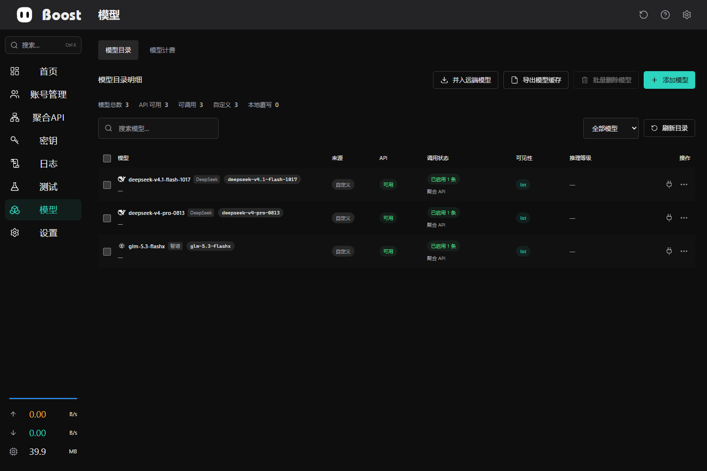
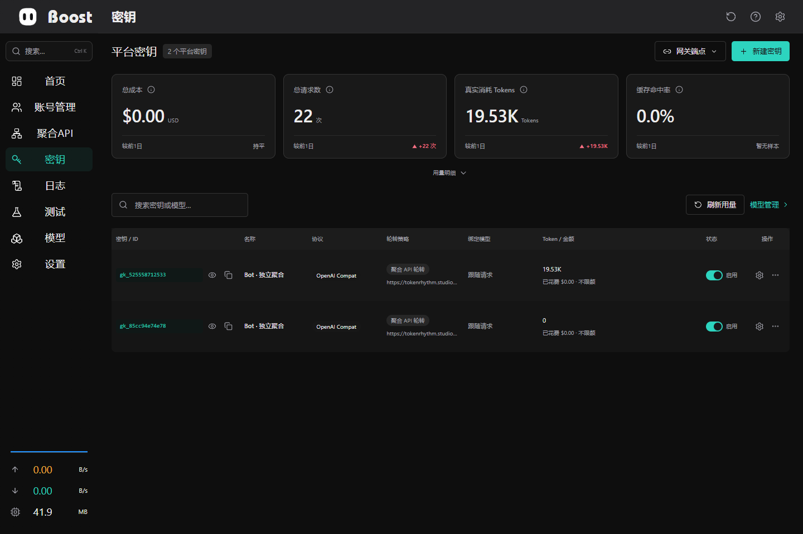
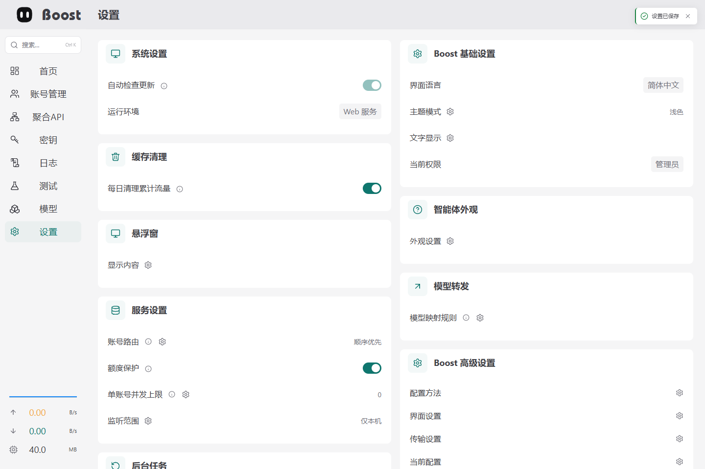
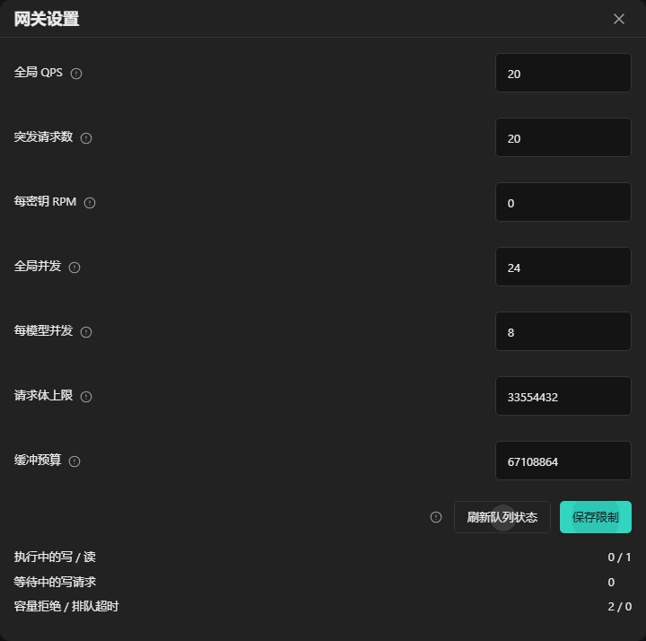
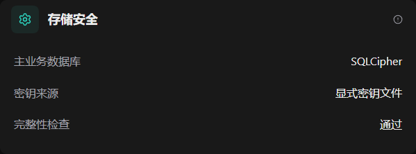

# Interface gallery

[简体中文](SCREENSHOTS.zh-CN.md) · [Project](../README.md)

Images are repository assets captured with isolated demonstration data. They illustrate the management and agent interfaces; release acceptance requires checking the packaged application.

**Dashboard**

 

**Account pool**

 

**Model workspace**

 

**Platform keys**

 

**Agent workspace**

 

**Appearance**

 

**Gateway settings**

 

**Storage security**

