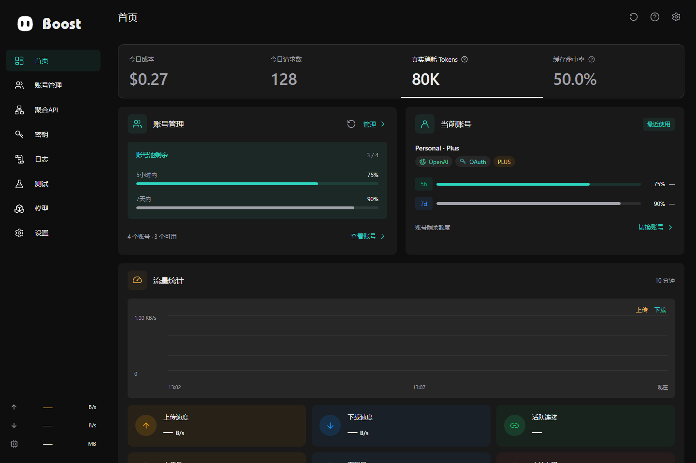
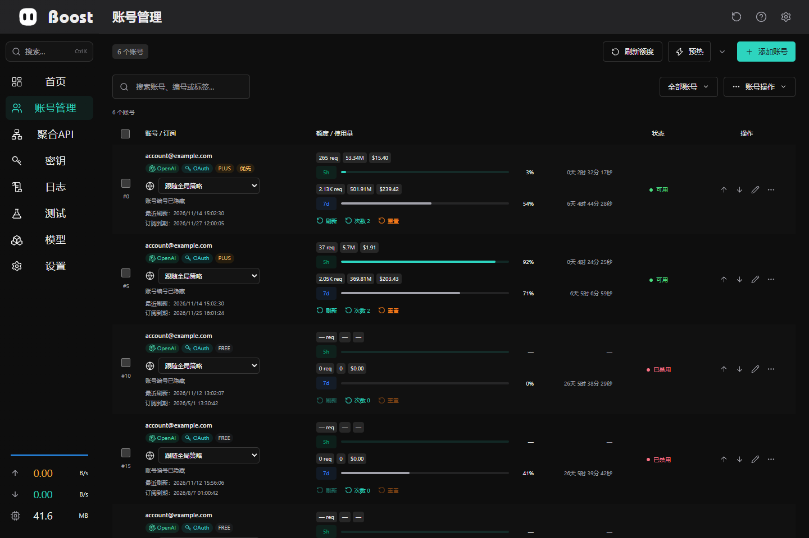
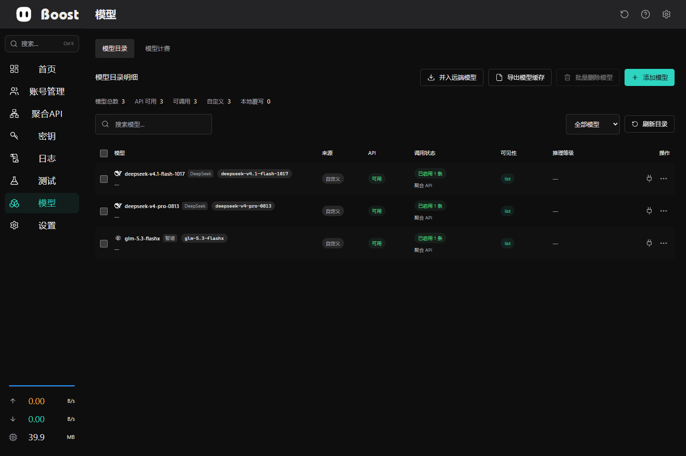
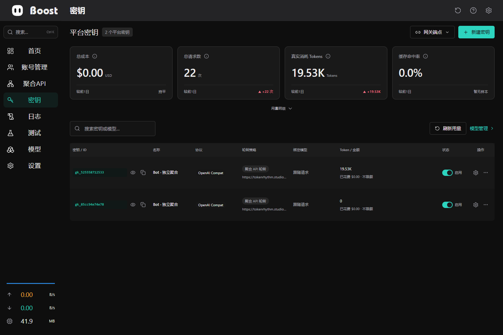
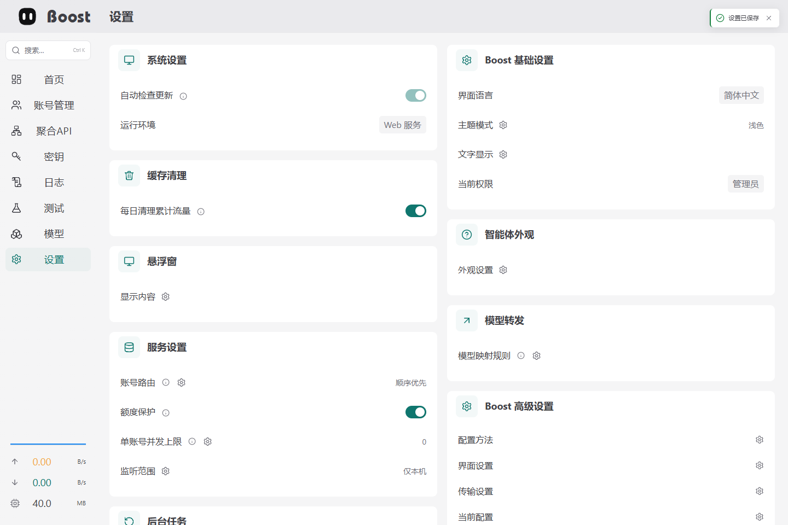
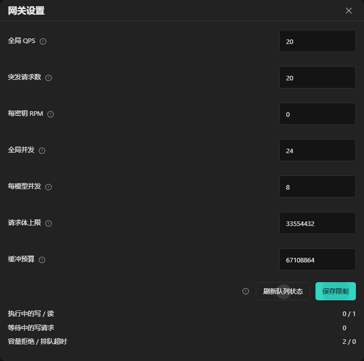
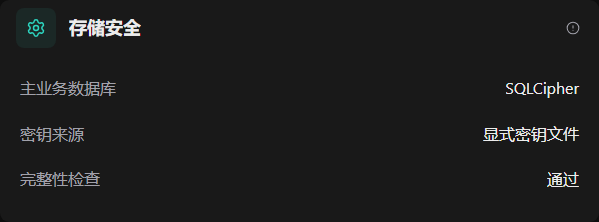

# 界面图集

[English](SCREENSHOTS.md) · [项目首页](../README.zh-CN.md)

图片采用仓库现有资源与隔离演示数据，展示管理界面和智能体界面；发布验收仍需检查实际安装包。

**总览**

 

**账号池**

 

**模型工作区**

 

**平台密钥**

 

**智能体工作台**

 

**外观**

 

**网关设置**

 

**存储安全**

