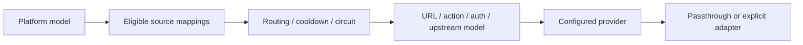

# Aggregate upstream routing

[简体中文](../../zh-CN/report/聚合API请求规则与配置说明.md) · [Gateway](../../../backend/service/src/gateway/README.md)

## Routing model

Aggregate connections are configured upstream providers, distinct from an authenticated account pool. A platform key selects account rotation, aggregate rotation or account-first hybrid fallback. Its preferred aggregate source does not bypass model mapping or ownership.

| Item | Meaning |
| --- | --- |
| Platform key | Client credential, protocol, model defaults and allowed routing |
| Aggregate source | Provider type, URL, secret, auth/action policy, status and balance query |
| Platform model | Public model ID with eligibility and visibility |
| Source mapping | Source ID, upstream model ID, enablement, priority, weight and optional billing model |

Only active and model-eligible sources enter routing. Imported aggregate models never create unrelated account-pool mappings. Remote discovery uses provider-specific model endpoints, including native pagination where supported.

## Request planning

| Policy | Contract |
| --- | --- |
| URL | Can be a configured final endpoint or supported provider base |
| Explicit action | Path-only override; retain required source prefix |
| Raw action | Use the configured URL without appending a guessed client path |
| Responses-to-chat bridge | Explicitly selected by current request-plan logic when targeting Chat Completions |
| Image routes | A text action must not silently turn an image operation into text |
| Model override | Rewrite to the mapped/explicit upstream model while retaining platform identity for authorization/logging |

Do not assume every base URL automatically appends /v1 or the client path. Review [request-plan implementation](../../../backend/service/src/gateway/upstream/protocol/aggregate_api.rs) and verify the resulting route with an isolated request.

## Authentication and balance

API-key sources default to Bearer authentication. Supported custom headers/query fields and username/password modes must be explicitly configured and validated. Secrets stay server-side; query-secret URLs must never be logged publicly.

Balance queries are provider-specific configured requests, not model access grants. Keep reported balance, currency/credit unit, timestamp and validity. Failed/unsupported balance queries do not become a fabricated zero. Local USD estimates are separate from provider invoices.

## Failure and resource behavior

Source circuits and existing retry/failover rules share the request's routing context. A half-open aggregate source permits one logical probe. Do not replay already-delivered SSE or unsafe tool effects. Admission, body memory and model limits are enforced before upstream work; temporary overload includes Retry-After.

Verify JSON/SSE, tool definitions/calls, model mapping, provider auth, source prefix/action, image/multipart bytes, error responses, cancellation, source circuit/failover and idempotent accounting. Cross-provider semantic compatibility requires actual supported upstreams.

## Ownership

Aggregate credentials and global routes remain administrator-controlled. Member keys and Bot bindings can select only authorized models/sources. UI convenience cannot weaken backend ownership or wallet policy. [Internal interface inventory](system-internal-interface-inventory.md) is generated from current dispatch rather than duplicated here.
