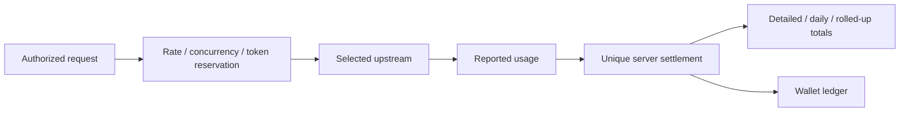

# Quota management and accounting

[简体中文](../../zh-CN/report/额度管理中心设计方案.md) · [Usage](../../USAGE.md) · [Resource limits](../../CONFIGURATION.md)

## Dimensions

| Source | Native quantity | Derived quantity | Confidence |
| --- | --- | --- | --- |
| Platform key | Local reported token totals and configured limit | Remaining local budget | Depends on complete upstream usage |
| Aggregate provider | Published balance/credits from a supported query | Estimated model-token capacity using prices | Estimate, not provider quota |
| Account pool | Usage-window percentage and reset time | Optional token/cost approximation | Window semantics remain authoritative |
| Wallet | Local credits and ledger | Request charges using model/billing rules | Local accounting, not an invoice |

Do not sum percentages, money and tokens as if they were one unit. Scope, currency, time window, price version, sample age and unknown values remain visible.

## Persistence and data flow

Core owns source capacity, key limits, price rules, request/token history and wallet records. Service owns model/source eligibility, price matching, usage extraction and authorization. Frontend displays the resulting scoped data.

## Prices

Official provider snapshots update atomically and preserve custom/other-provider rules. Model mappings may choose a distinct billing model. Matching includes supported model/tier/context distinctions. Failed downloads/parsing preserve the last valid snapshot.

USD estimates are distinct from upstream charges. Dated CNY/USD conversion is retained for supported TokenRhythm quotations. Images, audio, tools, storage and hidden context cannot be reduced to text pricing without a provider-specific contract.

## Enforcement

Rate, in-flight and cumulative quotas are separate. Process-local text reservation combines a positive requested output limit with conservative input bytes; unknown provider-added context/media are explicitly outside a proven hard cap. Multiple service processes do not share that reservation map.

Settlement identity is server-generated and key-scoped. Logs/token records commit atomically; wallet request deduction is idempotent. Historical unlabelled rows remain unchanged. Crash-persistent reservation/settlement recovery and provider reconciliation are follow-up gates, not implied by these controls.

## UI and validation

Present source/model/key aggregates, remaining/unknown states, price provenance and effective time. Members only receive owned data; global source policy is administrator-controlled. Missing usage must not appear as zero.

Verify expiry/window rollover, retained-history totals, custom-price preservation, ownership, duplicate settlement, concurrent budget admission and negative/unsupported balance responses. [Engineering plan](../../../update.en.md) distinguishes delivered controls from remaining audit, reconciliation and recovery work.
