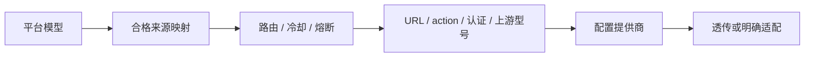

# 聚合上游路由

[English](../../en/report/aggregate-upstream-routing.md) · [网关](../../../backend/service/src/gateway/README.zh-CN.md)

## 路由模型

聚合连接是配置的上游提供商，区别于已授权账号池。平台 key 选择账号、聚合或账号优先混合兜底；首选聚合来源不绕过模型映射和归属。

| 项目 | 含义 |
| --- | --- |
| 平台 key | 客户端凭据、协议、默认模型和允许路由 |
| 聚合来源 | 提供商、URL、秘密、认证/action、状态与余额查询 |
| 平台模型 | 对外 ID、准入和可见性 |
| 来源映射 | 来源 ID、上游型号、启用、优先级、权重和可选计费模型 |

仅 active 且匹配模型的来源进入候选，聚合模型不产生无关账号映射。远端发现访问对应模型端点，支持的原生渠道按分页获取。

## 请求规划

| 策略 | 约定 |
| --- | --- |
| URL | 可为最终端点或支持的提供商基础路径 |
| 显式 action | 仅路径覆盖，保留必要来源前缀 |
| raw action | 使用配置 URL，不猜测追加客户端路径 |
| Responses 转 Chat | 当前请求规划在目标为 Chat Completions 时明确选择 |
| 图片路径 | 文本 action 不能静默将图片变成文本 |
| 模型覆盖 | 改为映射/显式上游型号，授权与日志保留平台身份 |

不能假设任意基础 URL 都自动追加 /v1 或客户端路径。按[实现](../../../backend/service/src/gateway/upstream/protocol/aggregate_api.rs)检查并用隔离请求验证。

## 鉴权与余额

API key 默认 Bearer；自定义头/query 及用户名密码模式须显式配置校验。秘密只在服务端，含 query 密钥的 URL 不能公开记录。

余额查询是提供商专属请求，不授予模型权限；保留余额、币种/积分单位、时间和有效性。失败/不支持不能填造零余额，本地 USD 估算也不等于账单。

## 故障与资源

熔断与既有重试/切换共享请求上下文，半开来源只允许一个逻辑探测；不重放已输出 SSE 或工具副作用。上游工作前限制准入、输入内存和模型在途，临时过载返回 Retry-After。

覆盖 JSON/SSE、工具、型号映射、认证、路径前缀/action、图片/multipart、错误、取消、熔断/切换和幂等记账。跨供应商语义兼容需真实受支持上游验证。

## 所有权

聚合凭据和全局路由由管理员管理，成员 key 与 Bot 只能选择有权限的模型/来源；不能为界面便利弱化归属和钱包。[内部接口目录](系统内部接口总表.md)由当前分发生成，本文不重复维护。
