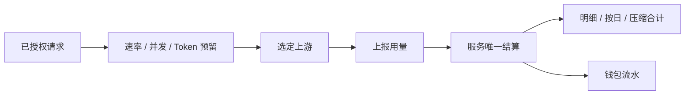

# 额度管理与计量设计

[English](../../en/report/quota-management-design.md) · [用量](../../USAGE.zh-CN.md) · [资源配置](../../CONFIGURATION.zh-CN.md)

## 数据维度

| 来源 | 原生量 | 派生量 | 可信边界 |
| --- | --- | --- | --- |
| 平台 key | 本地上报 Token 与配置限额 | 本地剩余预算 | 依赖上游 usage 完整 |
| 聚合提供商 | 受支持查询的余额/积分 | 按模型价格估算容量 | 估算，不等于上游额度 |
| 账号池 | 窗口百分比和重置时间 | 可选 Token/费用近似 | 以窗口语义为准 |
| 钱包 | 本地积分与流水 | 按价格/计费规则扣款 | 本地记账，不是上游账单 |

百分比、货币和 Token 不能作为同一单位相加。范围、币种、时间窗、价格版本、采样时间和未知状态必须保留。

## 持久化与数据流

Core 保存来源容量、key 限额、价格、请求/Token 历史和钱包；Service 决定来源准入、价格匹配、用量提取和授权，前端展示按身份裁剪的数据。

## 定价

官方快照原子更新并保留自定义及其他提供商规则，来源映射可指定独立计费模型。匹配按支持的模型、档位和上下文区分；下载/解析失败保留上次有效快照。

USD 估算与实扣不同，TokenRhythm 支持的人民币报价保留带日期汇率。图片、音频、工具、存储和隐藏上下文不能未经专属计费约定折算为文本。

## 执行边界

速率、在途和累计额度分别治理。进程内文本预留使用正的输出上限加保守输入字节；提供商额外上下文/媒体不属于已证明硬上界。多服务进程不共享预留表。

结算身份由服务生成并按 key 区分，日志/Token 同事务，钱包请求扣费幂等。历史无身份记录保持原样。崩溃持久预留/恢复和真实上游对账是额外门槛，不能由这些控制推断已完成。

## 展示与验证

按来源/模型/key 汇总，展示剩余/未知、价格依据和生效时间。成员仅接收自己数据，全局策略由管理员控制，缺失 usage 不能填零。

验证窗口重置、历史保留、自定义价格、归属、重复结算、并发预留和异常余额响应。[工程计划](../../../update.md)区分交付与待完成审计、对账和恢复。
