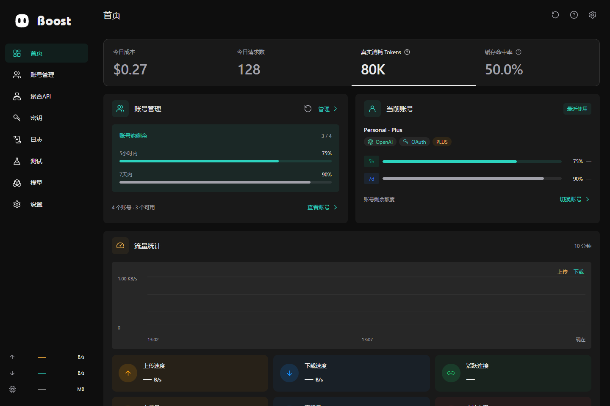

# Boost frontend

[简体中文](README.zh-CN.md) · [Project](../README.md) · [Build guide](../docs/BUILDING.md)

Vue 3, TypeScript and Vite provide the management interface for desktop and Web. The production Web entry is **http://localhost:12000**. The native desktop package lives separately in `backend/desktop/`.



## Layout

| Directory | Responsibility |
| --- | --- |
| `src/pages/` | Route-level management views |
| `src/components/` | Reusable controls, tables, dialogs and settings |
| `src/composables/` | UI state and runtime coordination |
| `src/lib/api/` | Typed clients and centralized Tauri/Web transport |
| `src/styles.css` | Global surfaces, accent colors and typography |

`boost-theme.js` restores appearance before first paint. The Bot avatar renderer is shared with `../bot/shared/appearance/`. UI preferences use versioned device storage; service policy remains backend-owned.

## Build and validation

From the repository root:

```bash
pnpm -C frontend install --frozen-lockfile
pnpm -C frontend run build
pnpm -C frontend run build:desktop
```

Static output is `frontend/out/`, including route-specific `index.html` files for Web and Tauri navigation. `build:desktop` currently delegates to the same static build. Vite alone does not provide authenticated RPC, sessions or Bot proxying. Standalone test directories, Playwright configuration and test package commands have been removed. Validate changed workflows in a running authenticated application; see [validation guidance](../TESTING.md).

For hot reload, use `pnpm -C frontend run dev:full`. Development-only ports and environment settings are documented in [BUILDING.md](../docs/BUILDING.md). See [engineering rules](AGENTS.md) before changing transport or UI behavior.

## Floating monitor

Settings → Floating monitor → Display content opens a borderless component library
with spring-based horizontal switching, a compact assembly preview underneath,
a black/white preview carousel and confirmation. Drag a library item into the
preview, drag installed items to reorder, and click the library item to remove it.
At least one item stays installed.

The preview and real floating window share their 32px rings and 42px horizontal
strip geometry. Task progress keeps its agent avatar; TPS always keeps its own
circle and reading; adjacent upload/download/memory readings stack compactly.
The preview has a thin outer border. Its black/white pages use the same spring, arrows and bottom dots as the component library. The selected appearance is saved locally for
the monitor and synchronized between windows without changing the main app theme.

Local activity samples independently of hosted Bot requests. Progress comes from
explicit reports or successful plan updates, with an indeterminate ring otherwise.
TPS uses reported output tokens and actual elapsed time; five seconds without a
sample clears it. Missing values are never fabricated.

Quota reset uses a dedicated confirmation styled consistently with the close
prompt. It shows the target account and available reset count, blocks duplicate
submissions and keeps upstream errors inside the dialog for an explicit retry.
