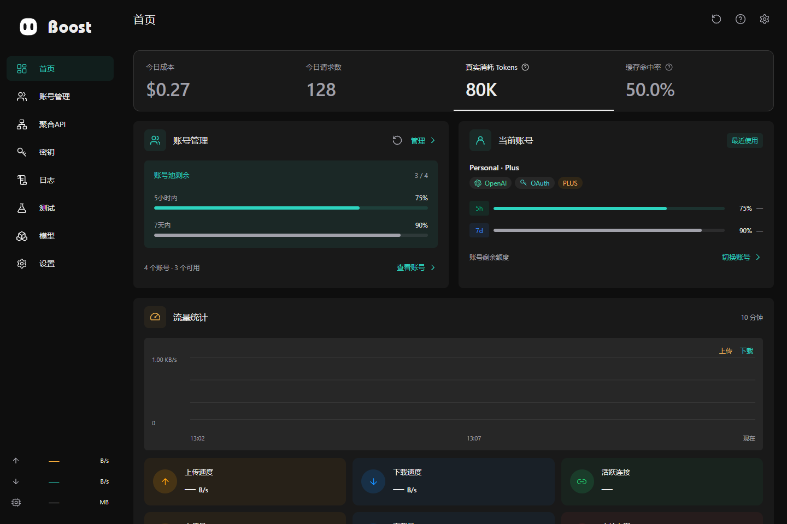

# Boost 前端

[English](README.md) · [项目首页](../README.zh-CN.md) · [构建指南](../docs/BUILDING.md)

管理界面使用 Vue 3、TypeScript 与 Vite，为桌面和 Web 共享。正常 Web 入口为 **http://localhost:12000**。原生桌面包独立位于 `backend/desktop/`。



## 目录职责

| 目录 | 职责 |
| --- | --- |
| `src/pages/` | 路由级管理页面 |
| `src/components/` | 控件、表格、对话框和设置组件 |
| `src/composables/` | 界面状态和运行时协调 |
| `src/lib/api/` | 类型化客户端及集中式 Tauri/Web 传输 |
| `src/styles.css` | 全局背景、强调色与文字样式 |

`boost-theme.js` 在首屏恢复外观，智能体头像与 `../bot/shared/appearance/` 共享渲染实现。界面偏好使用版本化设备存储，服务策略由后端管理。

## 构建与验证

从仓库根目录执行：

```bash
pnpm -C frontend install --frozen-lockfile
pnpm -C frontend run build
pnpm -C frontend run build:desktop
```

静态产物输出到 `frontend/out/`，保留各路由的 `index.html`，用于 Web 和 Tauri 直接导航。`build:desktop` 当前复用相同静态构建。单独 Vite 不提供会话、鉴权 RPC 和 Bot 代理。独立测试目录、Playwright 配置及测试命令已删除，请在已登录的运行实例中验证改动，详见[验证说明](../TESTING.md)。

热更新使用 `pnpm -C frontend run dev:full`。开发专用端口与环境配置见[构建指南](../docs/BUILDING.md)，传输或界面变更遵循[工程规范](AGENTS.md)。

## 悬浮窗

“设置 → 悬浮窗 → 显示内容”按顺序展示无边框组件库、底部紧凑装配效果、
黑／白双页预览与确认按钮。组件库左右切换使用弹簧动效；从库中拖入装配，
拖动已安装组件调整顺序，点击库中已启用的项可移除，至少保留一个组件。

预览与真实浮窗共用 32px 圆环和 42px 高的横条尺寸。任务进度保留智能体头像，
TPS 始终保留圆环和数值，上下行与内存读数紧凑堆叠。装配预览带细外框，黑／白使用与组件库相同的弹簧、左右箭头和底部两点切换；
黑／白外观仅影响悬浮窗，保存到本机并跨窗口同步，不改变主应用主题。

本机任务与内置 Bot 独立采样；进度来自明确上报或成功的计划更新，
没有可靠百分比时显示不定进度。TPS 使用实际输出 token 与耗时计算，
五秒无新样本即清空，不使用字符数或等待时间伪造数据。

额度重置采用与退出确认窗一致的专用布局，显示账号与可用次数。
提交时阻止重复操作；上游失败保留在弹窗中，由用户明确决定是否重试。
