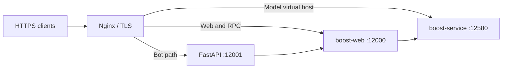

# Nginx deployment

[简体中文](README.zh-CN.md) · [Architecture](../ARCHITECTURE.md) · [Configuration](../docs/CONFIGURATION.md)

## Topology

[Nginx configuration](nginx.conf) is an optional deployment example. Direct Web remains port 12000. Replace example domains, certificate paths and upstream addresses before enabling it. Container loopback refers to the proxy container, not the service container.

## Routing and transport

| Route | Target | Requirements |
| --- | --- | --- |
| Web virtual host | boost-web | Preserve sessions and supported WebSocket upgrade |
| Exact `/api/rpc` | boost-web | 720 s read/send inactivity deadlines; upstream replay disabled |
| Model virtual host | boost-service | Preserve model paths, session anchors and streaming bytes |
| `/boost-bot/` | FastAPI → Boost Web | 512 connection cap, 32 MiB bodies, no replay/buffering/gzip, 3700 s stream inactivity deadline |
| Signed webhook locations | Service/Bot verification chain | Server-held RPC credential and explicitly selected actor |

Underscore headers carry session anchors; retain the configured header policy. SSE paths must not be buffered into one delayed response. WebSocket paths require upgrade forwarding. Keepalive values cache idle upstream connections and do not impose a shared execution budget.

Management writes are scheduled by service resources. A hot account lane does not consume all write execution slots. Proxy timeouts remain distinct from the 60-second application queue deadline. Never enable retries for submitted mutations to conceal an upstream error.

## Bot ingress

Enable the Python sidecar before the Nginx Bot location. See [FastAPI deployment](../bot/backend/api/README.md). Its per-worker limits are separate from the Nginx virtual-host connection cap and service/model budgets. Multiple workers or service processes do not create one global quota.

## Callbacks and identity

Use [custom-webhook.conf.example](custom-webhook.conf.example) for signed custom HTTP channels and [qq-webhook.conf.example](qq-webhook.conf.example) for QQ HTTPS callbacks. Keep internal RPC credentials in a server-only restricted configuration. Forward signature headers and derive the configured account's trusted actor server-side; do not accept actor headers from public clients.

Desktop uses the system-administrator actor; a hosted account must use its actual owner scope. A regular admin session is not interchangeable with the desktop identity. [Custom channel protocol](../bot/CUSTOM_CHANNEL.md) defines byte-level signatures and challenge behavior.

## Validation

Run `nginx -t` in the target environment before reload. Verify certificate chain, redirects, Web login, authorized RPC, both model endpoints, SSE first-byte delivery, WebSocket upgrade, disconnect cleanup, large/oversized bodies and explicit overload errors. A successful syntax check does not verify DNS, TLS or real upstream credentials.

[Header/cache diagnosis](../docs/en/report/nginx-reverse-proxy-cache-hit-issue.md)
