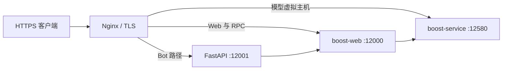

# Nginx 部署

[English](README.md) · [系统架构](../ARCHITECTURE.zh-CN.md) · [配置](../docs/CONFIGURATION.zh-CN.md)

## 拓扑

[配置文件](nginx.conf)是可选部署示例，直接 Web 入口仍为 12000。启用前替换域名、证书和 upstream。容器 loopback 指代理容器自身，不能代指其他服务容器。

## 路由与传输

| 路由 | 目标 | 要求 |
| --- | --- | --- |
| Web 虚拟主机 | boost-web | 保留会话和受支持的 WebSocket upgrade |
| 精确 `/api/rpc` | boost-web | 720 秒读写空闲期限，禁止上游重放 |
| 模型虚拟主机 | boost-service | 保留模型路径、会话锚点及流式字节 |
| `/boost-bot/` | FastAPI → Boost Web | 512 连接、32 MiB 请求体，关闭重放/缓冲/gzip，流空闲期限 3700 秒 |
| 签名回调位置 | Service/Bot 验证链 | 服务端持有 RPC 凭据并明确选择 actor |

下划线请求头承载会话锚点，保留相应头策略。SSE 不能被缓冲为延迟的整段响应，WebSocket 需要升级转发。keepalive 缓存空闲上游连接，不是共享执行预算。

管理写请求由服务端资源调度；热账号分片不占满所有写执行位。代理超时与应用 60 秒排队期限分开计算，不能启用写请求自动重试来掩盖错误。

## Bot 接入

先启动 Python sidecar，再启用 Nginx Bot location，详见 [FastAPI 部署](../bot/backend/api/README.zh-CN.md)。每 worker 限额、Nginx 虚拟主机连接上限与模型预算分别计算；多 worker/多服务进程不形成全局共享配额。

## 回调与身份

自定义渠道使用 [custom-webhook.conf.example](custom-webhook.conf.example)，QQ HTTPS 回调使用 [qq-webhook.conf.example](qq-webhook.conf.example)。内部 RPC 凭据放入受限的服务器配置，保留签名头，按账号真实归属由服务器选择 actor，不接受公网传入的身份。

桌面使用系统管理员 actor；服务部署使用实际账号作用域。普通 admin 会话不等于桌面身份。[渠道协议](../bot/CUSTOM_CHANNEL.zh-CN.md)定义原始字节签名与 challenge。

## 验证

在目标环境执行 `nginx -t` 后再重载。核查证书、跳转、Web 登录、受权 RPC、两个模型端点、SSE 首字节、WebSocket、断连清理、大请求体与过载响应。语法成功不代表 DNS、TLS 或真实上游已通过。

[请求头与缓存排障](../docs/zh-CN/report/Nginx反向代理导致缓存命中偏低说明.md)
